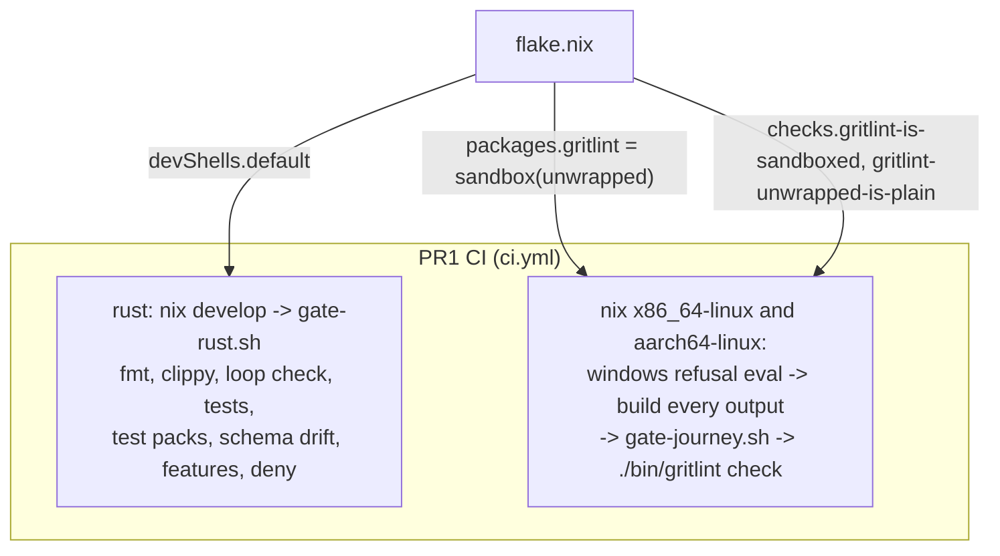
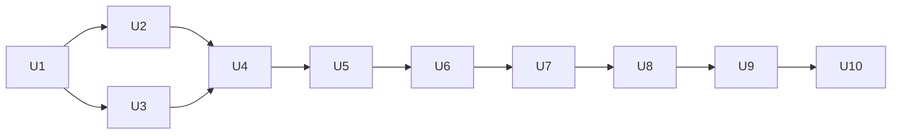

# gritlint as a standalone repository - Plan

## Goal Capsule

- **Objective:** gritlint lives in `systemfsoftware/gritlint`. A consumer switches by changing only its flake input URL, and later PRs make the tool measurably faster, agent-readable, fully tested, installable from a tarball, and usable from an editor.
- **Means:** seven stacked PRs on trunk `main`. PR1 is a faithful import of `systemfsoftware/systemfsoftware@df908ddfe497e53c1c03b92519a96c913c441a58` plus the flake, MIT licensing, the Rust gate and the dogfood conventions gate in CI. PR2 to PR7 deliver Unit B1 Done 7, 2, 3, 4, 5 and 6, in that order.
- **Product authority:** the Unit B1 round-3 contract, then the session rulings recorded as `session-settled` entries, then this plan, then planner judgment. Removing gritlint from the monorepo belongs to a later unit, which starts when PR1 merges.
- **Stop conditions:** stop and ask before adding any third-party executable, GitHub Action or library crate outside R11 and the approved list in KTD9; before copying any monorepo workflow, tooling or pack; before referencing a private repository, a secret or an environment; and before any push whose ancestry contains a monorepo commit.
- **Execution profile:** PR1 is planned to unit level and executed now. PR2 to PR7 are planned to unit level with test scenarios here, and each gets a ce-plan deepening pass when it starts, because each depends on numbers or code the earlier PR produces.
- **Open blockers:** none for PR1. Q1 and Q2 must be answered before PR6 and PR7.

---

## Product Contract

### Summary

Import gritlint unchanged, then rebuild what is unproven: per-run compilation, output shape, rule test coverage, packaging and editor integration. The import PR is small so the monorepo-removal unit can start early.

### Problem Frame

gritlint was built inside the monorepo, and its quality was never measured there. Each rule is compiled again for every directory it runs in (`decide.rs` `run_directory` -> `execute` -> `engine::run` -> `src_to_problem_libs`). A finding with no engine range is reported at line 1 (`decide.rs` `first_match` and `finding_for`). The JSON output has no `schemaVersion` and no reason codes. The npm wrapper (`npm/gritlint/package.json`) is a private stub with no `bin`. Nothing has been benchmarked. Consumers reach gritlint through the monorepo flake, which couples their lockfile to the whole monorepo.

GritQL stays the engine. Its multifile patterns and offline execution under bubblewrap are what gritlint offers that single-file engines (Biome plugins, ast-grep rules) do not.

### Key Decisions

- **Import from `df908ddf`, the monorepo's `main` tip.** (session-settled: user-directed — chosen over `cf6ab028` and `6a7c247b`: its gritlint paths equal `6a7c247b`'s, which add `packs/cell-architecture` and the matching `configuration_schema.json`.) No `.changeset/` intent file is imported. Governs R1.
- **PR1 is the faithful import; improvements come later.** (session-settled: user-directed — chosen over one large PR: the monorepo-removal unit waits on PR1.) Governs R1 to R11.
- **Stay on the GritQL crates, tracking `biomejs/gritql`.** (session-settled: user-directed — chosen over Biome plugins and ast-grep, which are single-file.) The crates stay a pinned git dependency and are never vendored. Governs R3.
- **Leave out of the import what has no consumer here.** `scripts/tools/gritlint/sync-version.ts` is only run by the monorepo's `gate:repo` selftest and its `--pins` mode feeds the retired npm platform packages; the release tooling's `cargo` surface writes `Cargo.toml` and `Cargo.lock` instead (PR6). The monorepo's origin plan and its Windows MAX_PATH solution describe monorepo history and a Windows npm publish this repo refuses to build. `docs/solutions/tooling-decisions/gritlint-conventions-platform.md` comes over as the design record. Governs R1.
- **Stack every PR on the previous one.** Every PR edits `flake.nix` or the CI workflow, so sibling PRs off `main` would conflict. PR1 merges first; GitHub retargets the rest. Governs the PR sequence.
- **Order the later PRs so each one makes the next cheaper or safer.** CI hygiene (PR2) comes first so later PRs run on cached builds. Performance (PR3) comes before output (PR4) and the fixture harness (PR5) because it rewrites the code they snapshot. Distribution (PR6) needs the final CLI. The editor surfaces (PR7) reuse PR4's findings.
- **Write this repo's own CI workflows.** At `df908ddf` the monorepo has no reusable Rust or Nix workflow: `reusable-checks.yml`, `reusable-smoke.yml` and `reusable-race.yml` drive pnpm workspaces. PR6 consumes `pnpm-release-management`'s reusable `release.yml` and `changeset-check.yml` at `8cd6e83009531de040cd9c03e1370b4966fd2a12`, the revision the monorepo's `main` calls at `df908ddf`. If O1 publishes a Rust or Nix workflow later, a follow-up adopts it pinned by SHA.
- **Ship release wiring with distribution (PR6), not PR1.** (session-settled: user-directed — still in force: drop `private` on `npm/gritlint`, changesets and GitHub Releases through the reusable workflow, no npm registry, and a flake check that no release output shadows `packages.<system>.gritlint`.) Until the tarball has a `bin` there is nothing to release.
- **Release through the monorepo's working caller, unchanged.** (session-settled: user-directed — chosen over the later `bc3b9b37` revision: `df908ddf`'s Release run succeeded on `8cd6e830`.) `release.yml` calls `systemfsoftware/pnpm-release-management/.github/workflows/release.yml@8cd6e83009531de040cd9c03e1370b4966fd2a12` with `ci-workflow: ci.yml` and the job permissions `contents: write`, `pull-requests: write`, `actions: write`, as `df908ddf:.github/workflows/release.yml` does; `changeset-check.yml` calls the sibling `changeset-check.yml` at the same SHA. Both are consumed from the org and never copied. No repository-settings change is a dependency: if the release workflow needs "Allow GitHub Actions to create and approve pull requests", PR6's description says so in one line, and nothing else changes. Governs R24.

### Requirements

**PR1 — import, identity and licence**

- R1. One commit adds exactly the files in Appendix A at the same paths, byte-identical to `df908ddf`, and cites that SHA. Later PR1 commits change only the files in Appendix B and add only the files in Appendix C.
- R2. No commit reachable from any pushed ref has a monorepo commit in its ancestry.
- R3. GritQL stays a git dependency on `biomejs/gritql` rev `4ca283484ab9bd11ca3cbc9e14b5ad2db5d61a37`.
- R4. Every licence surface is MIT under "System F Software": root `LICENSE`, `Cargo.toml`, `npm/gritlint/LICENSE`, and later `npm/gritlint/package.json`. Both LICENSE files carry the GritQL copyright notices, because the binary links GritQL statically.

**PR1 — flake contract**

- R5. `packages.<system>.gritlint` is the bubblewrap-sandboxed CLI and `packages.<system>.gritlint-unwrapped` is the plain build, for `x86_64-linux` and `aarch64-linux`. No darwin outputs.
- R6. Evaluating any output for `x86_64-windows` throws a message that names gritlint and both supported systems.
- R7. `nix flake check` builds the sandboxed package and fails when `packages.<system>.gritlint` stops isolating a run (it reads outside the working directory, writes the working directory, or keeps the caller's environment), when that name is bound to anything but the sandbox wrapper, or when `packages.<system>.gritlint-unwrapped` is not the compiled binary.

**PR1 — gates**

- R8. Rust gate: `scripts/tools/gate-rust.sh` runs unchanged on every PR and on `main`. It covers fmt, clippy `-D warnings`, the `decide.rs` loop check, the workspace tests, `gritlint test packs`, schema drift, the network-feature check and `cargo deny`.
- R9. Dogfood: `gritlint.json` names this repository in `npm-provenance.repositoryUrl`. CI shows the sandboxed binary exiting 1 on a planted `typecheck-build-mode` violation and 0 once fixed, exiting 1 under this repository's `gritlint.json` on a published package whose `repository.url` names the monorepo and 0 once it names this repository, each failure naming its rule, then `./bin/gritlint check` passing on this repository.
- R10. Nix lane: on `x86_64-linux` and `aarch64-linux` hosted runners, the R6 refusal holds and every flake output for that system builds.
- R11. CI uses standard hosted runners only, no secrets, environments or private repositories, every action pinned by commit SHA, and no executable beyond Nix, bubblewrap, the Rust toolchain and cargo-deny in PR1. Later PRs may add only the KTD9 tools.

**PR2 — Rust hygiene and CI cost (Done 7)**

- R12. The flake builds with crane, so dependency artifacts are a separate cached derivation. CI restores and saves Nix store paths without secrets.
- R13. Every check `scripts/tools/gate-rust.sh` runs becomes a flake check that each Nix job builds, except `cargo deny check`, which needs the network for advisories and stays a CI step. Tests run under cargo-nextest. `rust-version` in `Cargo.toml` is the pinned MSRV, and a check compiles the workspace with exactly that toolchain.
- R14. CI cost is measured on exact runs through the GitHub REST API. Each run records `billable.total_ms` from `/actions/runs/{id}/timing`, which is 0 on public repositories, and its job minutes: each job's `completed_at - started_at` from `/actions/runs/{id}/attempts/{n}/jobs`, rounded up to a whole minute, which is how GitHub bills a private repository. A cold run restores no cache. A warm run is a re-run attempt of the same run, after the first attempt saved its caches. PR2 measures a cold and a warm run of its own, PR1's run 38021222065 (cold) and a re-run attempt of it (warm), and the monorepo's gritlint lanes at `df908ddf` (the `rust` and `gritlint` jobs of CI run 38008617968 and both jobs of Nix run 38008617804, a warm `main` push). PR2's warm run costs fewer job minutes than PR1's warm run and the monorepo's, and the PR body records every number.

**PR3 — performance (Done 2)**

- R15. A run compiles each enabled rule once and makes one multithreaded pass over the selected files. The findings are the same as before for every input.
- R16. An in-repo Rust benchmark harness runs gritlint over a pinned public TypeScript corpus of at least 100k lines, which Nix fetches by hash and the repository never vendors. CI runs it on every PR and reports wall time for the PR1 binary and the current binary in the step summary.
- R17. The speedup on the corpus is at least 10x, or the PR states the measured ceiling and what bounds it.

**PR4 — agent-first output (Done 3)**

- R18. `--format json` emits a document with `schemaVersion`. Each finding carries `ruleId`, `reasonCode`, `nextAction`, and an exact location (path, start and end line and column) taken from the engine's range. A finding is never placed on a line the engine did not report.
- R19. A bounded concise reporter prints at most a fixed number of findings and a count of the rest. A GitHub reporter emits one annotation per finding and writes a step summary.

**PR5 — rule tests and mutation testing (Done 4)**

- R20. Every pack rule has at least one valid and one invalid case, run by a fixture and snapshot harness. Each case fails under at least one plausible defect, shown by a cargo-mutants mutant it kills.
- R21. cargo-mutants runs in CI on pushes to `main` only, never on pull requests and never locally. The PR cites the mutant ids the new cases target.

**PR6 — distribution and release (Done 5)**

- R22. The flake builds an npm-style tarball with a `bin` entry and binaries for `linux-x64` and `linux-arm64` that run outside Nix. Consumers install it from the tarball, never from an npm registry.
- R23. A CI consumer journey installs the tarball into a scratch project and runs `gritlint check` there.
- R24. `npm/gritlint` loses `private`. Changesets and GitHub Releases run through `pnpm-release-management`'s reusable workflows at `8cd6e830`, a changeset check guards `npm/gritlint/`, and a flake check fails if any release output shadows `packages.<system>.gritlint`.

**PR7 — editor and Biome surfaces (Done 6)**

- R25. `gritlint lsp` speaks the Language Server Protocol over stdio and publishes diagnostics for open files covered by the enabled packs.
- R26. `gritlint export biome` writes Biome GritQL plugin files for each single-file rule in a language Biome plugins support, and refuses every other rule with a reason code.

### Acceptance Examples

- AE1. **Covers R5.** **Given** a scratch consumer flake that builds `packages.x86_64-linux.gritlint` from `github:systemfsoftware/systemfsoftware`, **when** only its input URL changes to `github:systemfsoftware/gritlint/<PR1 branch>`, **then** the same attribute builds and `gritlint --version` prints `0.1.0`.
- AE2. **Covers R6.** **Given** this flake, **when** `nix eval --raw .#packages.x86_64-windows.gritlint` runs, **then** it exits non-zero and stderr names gritlint, `x86_64-linux` and `aarch64-linux`.
- AE3. **Covers R1.** **Given** `df908ddf` fetched into the clone, **when** every Appendix A path outside Appendix B is compared by blob hash and mode with the import commit, **then** all match.
- AE4. **Covers R7.** **Given** the flake, **when** `nix/gritlint-sandbox.nix` drops bubblewrap, binds the working directory writable, binds the host root, or keeps the environment, or `packages.<system>.gritlint` is rebound to `gritlint-unwrapped`, or `gritlint-unwrapped` to the wrapper, **then** `nix flake check` fails.
- AE5. **Covers R9.** **Given** `npm-provenance.repositoryUrl` set to this repo, **when** `./bin/gritlint check` runs at the root, **then** it exits 0.
- AE6. **Covers R15, R16.** **Given** the pinned corpus, **when** the benchmark runs the PR1 binary and the PR3 binary, **then** both produce the same findings and the step summary shows both wall times.
- AE7. **Covers R18.** **Given** a multifile rule that matches in a directory, **when** gritlint reports it in JSON, **then** the location is the engine's range for the matched node, or the run fails naming the rule.
- AE8. **Covers R23.** **Given** the PR6 tarball, **when** a scratch project installs it from the file and runs `gritlint check` with a planted violation, **then** it exits 1 with the finding.

### Scope Boundaries

- Removing gritlint from the monorepo and repointing consumers.
- Repository settings, including "Allow GitHub Actions to create and approve pull requests".
- darwin and Windows builds.
- Publishing to any npm registry.
- New packs, and changing what any existing rule matches, except where a PR5 case exposes a defect.
- Monorepo tooling: TypeScript toolchain, oxlint, dprint, comment-checker, the consumer-store lib, `deno-tool`, `repo-checks`, `test-timings`, and every monorepo workflow.

### Dependencies / Assumptions

- `df908ddf` is the monorepo's `main` at 2026-10-10 00:20 UTC. Its gritlint paths, `flake.lock`, `.github/actions/checks-lane/action.yml` and `.github/workflows/nix.yml` are identical to `6a7c247b`'s.
- The monorepo's locked `nixpkgs` is `aa48d347080940b8a2b8d2f48228674e280a3514` and `rust-overlay` is `368fee9beaab04ca6fe7af28db63caa9badb22fa`. `nix/gritlint.nix`'s `cargoHash` was produced by that nixpkgs.
- GritQL's `Problem::execute_files` takes `&self`, so one compiled problem can run over many file sets, and it already runs single-file patterns over files in parallel with rayon (`crates/core/src/problem.rs:318`, `:488-500` at `4ca28348`). Multifile patterns run sequentially within one call.
- Biome plugins are `.grit` files that call `register_diagnostic` and declare a target language (biomejs.dev/linter/plugins). Which Biome release added JSON targets is checked in PR7.

### Outstanding Questions

- Q1. *(Resolve Before PR7)* Verifying the Biome export by running Biome needs Biome as a third-party executable, which is not on the approved list. Without approval, PR7 checks exported plugins by compiling them with gritlint's own GritQL engine plus a stub `register_diagnostic`, which proves syntax but not Biome's acceptance.
- Q2. *(Resolve Before PR6)* A tarball binary that runs outside Nix must be statically linked (musl). If crane cannot cross-build the `aarch64-linux` musl binary on the `x86_64-linux` runner, PR6 needs the tarball assembled from both runners' outputs, which turns the tarball into a CI artifact rather than a single flake output. Deferred to PR6 planning; ask only if neither shape works.
- Q3. *(Deferred to Planning)* The PR3 corpus. The candidate is `Effect-TS/effect` at a fixed commit: it is public, well over 100k lines of TypeScript, and has a `package.json`, `tsconfig.json` and `vitest.config.ts` per package, which are the files the packs target.

<!-- ce-section: work-relationships -->
### Work Relationships

| PR | Delivers | Stacks on | Branch |
| --- | --- | --- | --- |
| PR1 | R1 to R11 (Done 1) | `main` | `feat/import-gritlint` |
| PR2 | R12 to R14 (Done 7) | PR1 | `feat/crane-ci` |
| PR3 | R15 to R17 (Done 2) | PR2 | `feat/single-pass-engine` |
| PR4 | R18, R19 (Done 3) | PR3 | `feat/agent-output` |
| PR5 | R20, R21 (Done 4) | PR4 | `feat/rule-harness` |
| PR6 | R22 to R24 (Done 5) | PR5 | `feat/tarball-release` |
| PR7 | R25, R26 (Done 6) | PR6 | `feat/lsp-biome-export` |

---

## Planning Contract

### Key Technical Decisions

- KTD1. **The flake carries only gritlint.** Inputs are `nixpkgs` and `rust-overlay`, locked to the monorepo's revisions (Dependencies / Assumptions), so `nix/gritlint.nix`'s `cargoHash` and the store paths stay valid. `forEachSystem`, `rust` and the version read from `Cargo.toml` come from the monorepo's `flake.nix:27-44`, with the refusal message naming gritlint. There is no `comment-checker` input, and no `pnpm-release-management` input until PR6. Governs R5, R6.
- KTD2. **R7's checks run the exported attributes.** `checks.<system>.gritlint-is-sandboxed` rebuilds `packages.<system>.gritlint` with `.override { gritlint = probe; }`, where the probe is a script that exits 1 naming each escape it achieves, and runs it inside the build from a working directory beside a file it must not see. The probe first runs unwrapped and must report escapes, so a probe that sees nothing fails the check. Rebinding the name to `gritlint-unwrapped` fails the `override`, which `nix/gritlint.nix` does not accept. `checks.<system>.gritlint-unwrapped-is-plain` requires `bin/gritlint` to be an ELF binary that prints `gritlint <Cargo.toml version>`. `checks.<system>.gritlint` is the package itself, because `nix flake check` evaluates packages without building them and builds only checks. Governs R7.
- KTD3. **One CI workflow, two job kinds.** `rust` runs `nix develop --command sh scripts/tools/gate-rust.sh` with the monorepo lane's cargo cache (`checks-lane/action.yml:117-145`), restored everywhere and saved on `main` only. `nix` runs per system: the refusal eval; the AppArmor user-namespace sysctl, which R7's checks need because they run bubblewrap inside the build; a build of every attribute of every flake output that has that system, with output kinds and attribute names both enumerated through `nix eval` so a new output cannot skip CI; then `scripts/tools/gate-journey.sh` and `./bin/gritlint check` against the binary it just built. Folding the journey into the Nix job reuses that build, where the monorepo's separate `gritlint` lane built it again. The closure cache keyed on the sandboxed output path (`checks-lane/action.yml:149-182`) carries over. Governs R8 to R10.
- KTD4. **Actions pinned by SHA:** `actions/checkout` v7.0.1 `3d3c42e5aac5ba805825da76410c181273ba90b1`, `cachix/install-nix-action` v31.11.1 `13d8dd58da0234aa297dedd986986ccb8e7f3e24`, `actions/cache` v6.1.0 `55cc8345863c7cc4c66a329aec7e433d2d1c52a9`. These are the actions the monorepo lanes already use. Governs R11.
- KTD5. **The dev shell holds the `rust-toolchain.toml` toolchain and `cargo-deny`.** Nothing else runs in PR1's gate. Governs R8, R11.
- KTD6. **PR1 adds no tests.** The imported suites run under R8. R7's checks and R9's journey are gates over contracts this plan states, run by `nix flake check` and CI, and each was shown to go red on a planted break. Governs R7 to R9.
- KTD7. **PR3's baseline is built from git, never checked in.** The benchmark job builds `packages.<system>.gritlint-unwrapped` at PR1's merge commit and at the PR head, so the baseline is reproducible. Governs R16, R17.
- KTD8. **Test layers for later PRs, from the admission gate.** PR3: a differential check, PR1 binary against PR3 binary on the corpus, inside the benchmark. PR4: in-process tests through `gritlint_core`'s public API, including a regression case for the line-1 fallback. PR5: one fixture case per rule outcome, plus mutation evidence. PR6: one packed-install journey. PR7: in-process LSP tests over `lsp-server`'s in-memory connection, and export snapshots. Only the two CI journeys (R9, R23) run the binary as a process. Governs R15 to R26.
- KTD9. **Approved tools for later PRs:** crane (a Nix library), cargo-nextest, cargo-deny, cargo-mutants (CI on `main` only), and in PR6 pnpm, node, `pnpm-release-management`'s `sandbox` and its reusable workflows at `8cd6e83009531de040cd9c03e1370b4966fd2a12`. For PR7, `lsp-server` (maintained by rust-lang in the rust-analyzer repository) and `lsp-types` (maintained by the gluon-lang organisation), each admitted through cargo-deny. Anything else stops for approval. Governs R11.
- KTD10. **crane builds over the pinned vendor tree.** `nix/gritlint.nix` keeps `rustPlatform.fetchCargoVendor` with the existing `cargoHash`, because crane's own git vendoring would face the duplicate crate names and submodule-only crates that `gritlint.nix` documents. A small derivation copies the vendor's `source-git-0`, adds `resources/node-types` from the pinned engine checkout beside it (replacing `preBuild`), links `source-registry-0`, and writes `config.toml` with `@vendor@` resolved. crane takes it as `cargoVendorDir`. Governs R12.
- KTD11. **Two dependency derivations.** The package builds against release-profile dependencies (fat LTO, one codegen unit). clippy, nextest and `cargo tree` share dev-profile dependencies, because linking each test binary under fat LTO would cost more than a second dependency build. The dependency derivations and the vendor tree are `passthru` on `gritlint-unwrapped`. Governs R12, R13.
- KTD12. **The Rust gate becomes flake checks.** `checks.<system>` gains `gritlint-fmt`, `gritlint-clippy` (`-D warnings`, all targets), `gritlint-nextest`, `gritlint-packs` (`gritlint test packs` with the built CLI), `gritlint-schema` (the built CLI's `schema` against `npm/gritlint/configuration_schema.json`), `gritlint-decide-loops` and `gritlint-engine-features`, each carrying `gate-rust.sh`'s logic. `checks.x86_64-linux.gritlint-msrv` runs `cargo check --workspace --all-targets` with the toolchain read from `rust-version`, on one system because language support does not vary by architecture. `gate-rust.sh`, the `rust` job and its cargo cache are deleted. `cargo deny check` runs in the `x86_64-linux` Nix job through `nix develop`, after the build has realised the dev shell. The dev shell gains cargo-nextest. Governs R13.
- KTD13. **One Nix store cache per system.** The key is a hash of every build target's output path, with that system's prefix as the restore key, so an exact hit means nothing to build and a prefix hit still carries the dependency derivations. Restore with `nix copy --no-check-sigs --from file://`. On a miss, export every path in the closure of the targets' derivations, outputs included, that has no signature and is not a `.drv`: locally built or restored, never substitutable from cache.nixos.org. Saving happens on every ref, because GitHub scopes caches by ref. This replaces PR1's closure cache. Governs R12.
- KTD14. **Cost from the exact runs.** `/timing` is read for every measured run and recorded as is. Job minutes come from the jobs API of the named attempt. Warm runs are produced with `gh run rerun` on the cold run, so the commit and ref stay the same. A re-run rebuilds nothing, which flatters it. The table therefore also reports, for information, the first PR2 run on a new commit after the cold run: it restores through the prefix key and recompiles only the workspace. Governs R14.
- KTD15. **PR2 adds no tests.** The KTD12 checks carry `gate-rust.sh`'s existing logic. The red probes in U5 run on scratch copies and are deleted, per the admission gate. Governs R13.

### High-Level Technical Design

### Risks

| Risk | Consequence | Handling |
| --- | --- | --- |
| bubblewrap cannot create user namespaces on `ubuntu-24.04` runners | the journey fails | the monorepo's AppArmor sysctl step carries over |
| A consumer evaluates the `x86_64-windows` attributes | evaluation throws by design (R6) | `nix flake check` evaluates the current system only; AE2 runs the refusal eval explicitly, locally in U3 and in CI |
| The cold cargo build of the GritQL crates | slow first CI runs | PR2's crane dependency derivations and store cache (KTD10 to KTD13) |
| A dependency needs a newer compiler than `rust-version` | `gritlint-msrv` fails | raise `rust-version` to the measured minimum, which keeps the declared MSRV true |
| The store-cache bundle outgrows its savings | warm runs spend more on restore than they save | measured in R14; the export set excludes everything cache.nixos.org can substitute |

---

## Implementation Units

### U1. Verbatim import (PR1)

- **Goal:** the Appendix A files, byte-identical to `df908ddf`.
- **Requirements:** R1 to R3.
- **Dependencies:** none.
- **Files:** Appendix A.
- **Approach:** `git archive df908ddf <paths>` extracted into the work tree of `feat/import-gritlint`, which is cut from `main` at `1682ab5`. The monorepo commit is never checked out, merged or used as a base.
- **Test scenarios:** Test expectation: none -- a file copy; AE3 is the proof.
- **Verification:** AE3 over all 191 files; `git merge-base HEAD df908ddf` finds no common ancestor.

### U2. Identity and licence (PR1)

- **Goal:** imported metadata names this repository, and every licence surface is MIT under "System F Software" with the GritQL notices.
- **Requirements:** R4, R9.
- **Dependencies:** U1.
- **Files:** Appendix B, root `LICENSE`.
- **Approach:** point `[workspace.package] repository`, `nix/gritlint.nix` `meta.homepage` and `gritlint.json`'s `repositoryUrl` at this repo. Drop the `repos/**` ignore, which names a monorepo directory, and reword the "whole monorepo" comment. Point `bin/gritlint`'s no-nix message at the Nix installer instead of a CONTRIBUTING.md this repo does not have. Change `npm/gritlint/LICENSE`'s first holder, and add the two GritQL copyright lines to the root `LICENSE`.
- **Test scenarios:**
  - AE5: `./bin/gritlint check` exits 0 at the root.
  - `cargo metadata --no-deps` reports this repository for both crates.
- **Verification:** `git diff df908ddf HEAD -- <Appendix B paths>` shows only those edits.

### U3. Flake (PR1)

- **Goal:** the flake outputs consumers use today, served from this repository.
- **Requirements:** R5 to R7; KTD1, KTD2, KTD5.
- **Dependencies:** U1.
- **Files:** `flake.nix`, `flake.lock`, `.gitignore`.
- **Approach:** KTD1 and KTD2, locked to the KTD1 revisions. `.gitignore` carries `/target/`, `/result`, `/result-*` and `.direnv/`.
- **Test scenarios:**
  - `nix build .#packages.x86_64-linux.gritlint` succeeds and `result/bin/gritlint --version` prints `0.1.0`.
  - AE2 holds.
  - AE4: each break it lists, made in a scratch copy, fails the matching check; the copies are deleted.
  - `nix flake check` passes.
  - AE1 after the branch is pushed: a scratch consumer flake outside the repo builds `packages.x86_64-linux.gritlint` through `github:systemfsoftware/gritlint/feat/import-gritlint`. The result goes in the PR body.
- **Verification:** the scenarios above, run locally.

### U4. CI (PR1)

- **Goal:** the PR head shows the Rust gate, the Nix build of every output on both systems, and the dogfood journey.
- **Requirements:** R8 to R11; KTD3, KTD4.
- **Dependencies:** U2, U3.
- **Files:** `.github/workflows/ci.yml`, `scripts/tools/gate-journey.sh`.
- **Approach:** KTD3. Triggers are every pull request, whatever its base, so stacked PRs run CI, plus pushes to `main` and `workflow_dispatch`, with `permissions: contents: read`; concurrency cancels superseded PR runs.
- **Test scenarios:**
  - Locally, `nix develop --command sh scripts/tools/gate-rust.sh` exits 0.
  - Locally, `sh scripts/tools/gate-journey.sh <sandboxed gritlint>` exits 0, where this host permits user namespaces.
  - The journey exits 1 naming the case when a planted violation does not exit 1 or does not name its rule.
- **Verification:** the `rust` job and both `nix` jobs green on the PR head; job durations recorded as PR2's baseline.

### U5. Crane, nextest, MSRV and CI cost (PR2)

- **Goal:** cached Rust builds and a cheaper CI, measured.
- **Requirements:** R12 to R14.
- **Approach:** KTD10 to KTD14. `nix/gritlint.nix` returns the crane package with its dependency derivations and vendor tree in `passthru`. `flake.nix` adds the `crane` input and the KTD12 checks. `ci.yml` drops the `rust` job, replaces the closure cache with the KTD13 store cache, and runs `cargo deny check` on `x86_64-linux`.
- **Test scenarios:**
  - A source-only edit changes the gritlint derivation but not either dependency derivation's `drvPath`.
  - A `let` chain (stable in 1.88) in a scratch copy fails `gritlint-msrv`.
  - Each KTD12 check goes red on a planted break in a scratch copy: unformatted code, a clippy warning, a failing test, a broken pack fixture, an edited schema file, a `for` loop in `decide.rs`.
  - `gritlint-is-sandboxed`, `gritlint-unwrapped-is-plain`, AE2 and the journey still pass on the crane build.
  - The cold run and its re-run attempt are measured; the warm attempt's job minutes are below PR1's warm attempt and the monorepo's lanes.
- **Verification:** the R14 table in the PR body; every job green on the PR head.

### U6. Compile once, one parallel pass, benchmark (PR3)

- **Goal:** R15 to R17.
- **Approach:** compile each rule's GritQL problem once per run and reuse it for every directory batch; run rule-by-batch work on a rayon pool; read and parse each file once. The benchmark is an in-repo Rust binary over the Q3 corpus, fetched by Nix with a fixed hash; the baseline follows KTD7.
- **Test scenarios:**
  - On the corpus, the PR1 and PR3 binaries emit identical findings (differential, inside the benchmark).
  - One scan run with different thread counts emits identical, canonically ordered output.
  - A multifile rule over many directories is compiled once, shown by a compile count in the run statistics.
- **Verification:** the CI step summary with both wall times and their ratio.

### U7. Agent-first output (PR4)

- **Goal:** R18, R19.
- **Approach:** a versioned JSON envelope with `schemaVersion`. Each rule declares `reasonCode` and `nextAction` in its frontmatter, validated at load. Locations come only from engine ranges, and a match with no range fails the run naming the rule. The concise and GitHub reporters are pure encoders.
- **Test scenarios:**
  - Regression: a multifile match whose first file has no range is reported at the engine's range, never at line 1.
  - A rule without `reasonCode` fails to load with an error naming the rule file.
  - The concise reporter, given more findings than its bound, prints the bound and the remainder count.
  - GitHub annotations escape `%`, `\r`, `\n`, `:` and `,` in messages and paths.
- **Verification:** `gritlint schema` covers the new envelope; the dogfood journey reads the JSON.

### U8. Rule fixture harness and mutation testing (PR5)

- **Goal:** R20, R21.
- **Approach:** every rule gets valid and invalid cases with snapshot output, and `gritlint test packs` fails on a rule that lacks either. A `mutants` workflow runs cargo-mutants on pushes to `main`.
- **Test scenarios:**
  - Removing a rule's valid case fails `gritlint test packs` naming the rule.
  - A snapshot that disagrees with the output fails and shows the difference.
  - Each new case is listed against the mutant id it targets, taken from the CI job's `cargo mutants --list`.
- **Verification:** the first `main` run's caught and missed report, cited in a follow-up.

### U9. Tarball, release and changeset check (PR6)

- **Goal:** R22 to R24.
- **Approach:** statically linked binaries per platform (Q2), a launcher `bin` that selects by platform and architecture, and the tarball as a flake output. The change that drops `private` from `npm/gritlint/package.json` also adds `repository.url` naming this repository and `publishConfig` with `access: "public"` and `provenance: true` (inert, since nothing publishes to a registry), so the `npm-provenance` pack keeps R9's dogfood gate green. `release.yml` is the `df908ddf` caller verbatim: the reusable `release.yml` at `8cd6e830` with `ci-workflow: ci.yml` and `contents: write`, `pull-requests: write`, `actions: write`. `changeset-check.yml` calls the sibling at `8cd6e830` in its default mode (`devshell: false`: `pnpm/action-setup`, `actions/setup-node`, `pnpm install --frozen-lockfile`). `release.jsonc` adapts the monorepo's. KTD2's check extends to every release output. The PR description carries a one-line note if the release workflow needs "Allow GitHub Actions to create and approve pull requests"; that is not a blocker.
- **Test scenarios:**
  - AE8 in CI.
  - An unsupported platform gets an error naming the supported ones.
  - A PR touching `npm/gritlint/` without an intent fails the changeset check.
- **Verification:** the consumer journey green on both systems; a local release dry run.

### U10. LSP and Biome export (PR7)

- **Goal:** R25, R26.
- **Approach:** `gritlint lsp` on `lsp-server` and `lsp-types`, reusing PR4's findings and PR3's compiled rules. `gritlint export biome` renders single-file rules into `.grit` plugins with `register_diagnostic` and refuses the rest with reason codes.
- **Test scenarios:**
  - Opening a file with a violation publishes one diagnostic at the engine range; fixing it publishes an empty set.
  - The exporter refuses a multifile rule with its reason code.
  - One exported-plugin snapshot per exportable rule; Q1 decides how they are validated.
- **Verification:** the in-process tests and Q1's validation.

---

## Verification Contract

| Gate | Command or check | Proves |
| --- | --- | --- |
| Provenance | AE3 blob-hash and mode comparison | R1 |
| Ancestry | `git merge-base HEAD df908ddfe497e53c1c03b92519a96c913c441a58` exits 1 | R2 |
| Rust gate | `nix develop --command sh scripts/tools/gate-rust.sh` | R3, R8 |
| Flake | `nix flake check`; AE2; the AE4 probes; `nix build` of each output | R5 to R7 |
| Licence | root `LICENSE` and `npm/gritlint/LICENSE` name "System F Software" and carry the Iuvo AI and Biome Developers notices; `Cargo.toml` declares `license = "MIT"` | R4 |
| Dogfood | `./bin/gritlint check`; `scripts/tools/gate-journey.sh` | R9 |
| Consumer switch | AE1 scratch consumer flake | R5 |
| CI | `ci.yml` green on the PR head on both systems, read through `run_watch` | R8 to R11 |
| PR2 gate | `nix build` of every `checks.<system>` attribute; `nix develop --command cargo deny check` | R12, R13 |
| PR2 cost | R14 table from `/timing` and the attempt jobs API | R14 |

## Definition of Done

- Every PR1 unit's verification holds, and AE1, AE3 and the AE4 probe are recorded in the PR body.
- One PR from `feat/import-gritlint` into `main`, a single-layer `gh stack`, CI green on its head.
- The PR body cites `df908ddfe497e53c1c03b92519a96c913c441a58`.
- No PR1 file outside Appendices A to C changes, and no scratch probe remains.
- No force-push, and no monorepo commit in any pushed ancestry.

---

## Appendix

### A. Imported files (at `df908ddf`; 191 files)

| Source path | Files |
| --- | --- |
| `apps/gritlint/` | 2 |
| `crates/gritlint_core/` (sources, tests, `tests/fixtures/engine/**`) | 28 |
| `packs/cell-architecture/**` | 16 |
| `packs/npm-provenance/**` | 33 |
| `packs/source-resolution/**` | 83 |
| `packs/typecheck-build-mode/**` | 14 |
| `Cargo.toml`, `Cargo.lock`, `rust-toolchain.toml`, `clippy.toml`, `deny.toml` | 5 |
| `npm/gritlint/` (`package.json`, `README.md`, `LICENSE`, `configuration_schema.json`) | 4 |
| `nix/gritlint.nix`, `nix/gritlint-sandbox.nix` | 2 |
| `bin/gritlint` | 1 |
| `gritlint.json` | 1 |
| `scripts/tools/gate-rust.sh` | 1 |
| `docs/solutions/tooling-decisions/gritlint-conventions-platform.md` | 1 |

### B. Imported files changed in PR1

| Path | Change |
| --- | --- |
| `Cargo.toml` | `[workspace.package] repository` |
| `nix/gritlint.nix` | `meta.homepage`; the "whole monorepo" comment reworded |
| `gritlint.json` | `repositoryUrl`; `repos/**` ignore removed |
| `npm/gritlint/LICENSE` | first holder "System F Software" |
| `bin/gritlint` | no-nix message |
| `docs/solutions/tooling-decisions/gritlint-conventions-platform.md` | `module`, `related_components`, and the dprint link pointed at the monorepo at `df908ddf` |

Root `LICENSE`, the one pre-existing file, gains the GritQL notices.

### C. New files in PR1

| Path | Unit |
| --- | --- |
| `flake.nix`, `flake.lock`, `.gitignore` | U3 |
| `.github/workflows/ci.yml`, `scripts/tools/gate-journey.sh` | U4 |
| `docs/plans/2026-10-10-0332-feat-gritlint-standalone-plan.md` | PR1's issue of this plan |
| a `docs/solutions/` learning from ce-compound, if one is recorded | — |
