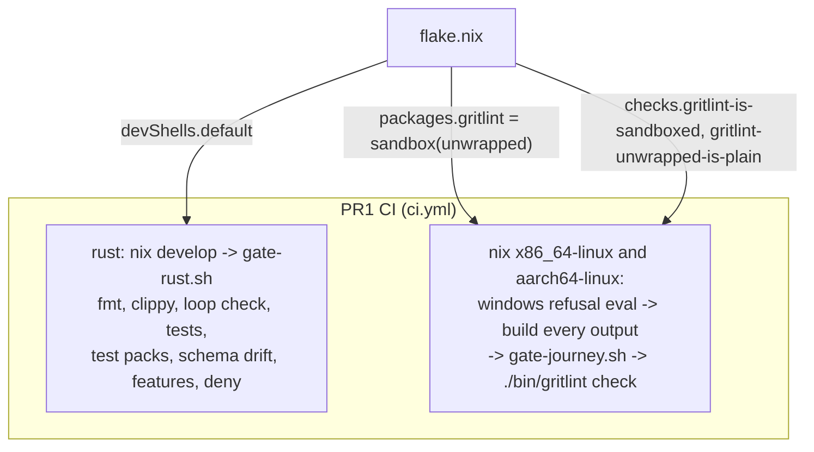
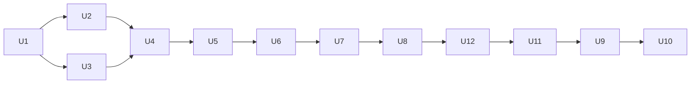

# gritlint as a standalone repository - Plan

## Goal Capsule

- **Objective:** gritlint lives in `systemfsoftware/gritlint`. A consumer switches by changing only its flake input URL, and later PRs make the tool measurably faster, agent-readable, fully tested, installable from a tarball, and usable from an editor.
- **Means:** seven stacked PRs on trunk `main`. PR1 is a faithful import of `systemfsoftware/systemfsoftware@df908ddfe497e53c1c03b92519a96c913c441a58` plus the flake, MIT licensing, the Rust gate and the dogfood conventions gate in CI. PR2 to PR7 deliver Unit B1 Done 7, 2, 3, 4, 5 and 6, in that order.
- **Product authority:** the Unit B1 round-3 contract, then the session rulings recorded as `session-settled` entries, then this plan, then planner judgment. Removing gritlint from the monorepo belongs to a later unit, which starts when PR1 merges.
- **Stop conditions:** stop and ask before adding any third-party executable, GitHub Action or library crate outside R11 and the approved list in KTD9; before copying any monorepo workflow, tooling or pack; before referencing a private repository, a secret or an environment; and before any push whose ancestry contains a monorepo commit.
- **Execution profile:** PR1 is planned to unit level and executed now. PR2 to PR7 are planned to unit level with test scenarios here, and each gets a ce-plan deepening pass when it starts, because each depends on numbers or code the earlier PR produces.
- **Open blockers:** PR7 waits on three rulings, each with a recommended answer: Q1 (Biome as a check-only executable, a stop condition), Q11 (what the export is tested against) and Q15 (where the exporter writes). PR6 has none: Q2 and Q10 are resolved here (KTD32 to KTD38), Q12 to Q14 were ruled on (KTD39 carries Q13), and the root's corrections of 2026-10-11 (base merge, the `b9b4a1d` pin, KTD40 to KTD42) are folded in.

---

## Product Contract

### Summary

Import gritlint unchanged, then rebuild what is unproven: per-run compilation, output shape, rule test coverage, packaging and editor integration. The import PR is small so the monorepo-removal unit can start early.

### Problem Frame

gritlint was built inside the monorepo, and its quality was never measured there. Each rule is compiled again for every directory it runs in (`decide.rs` `run_directory` -> `execute` -> `engine::run` -> `src_to_problem_libs`). A finding with no engine range is reported at line 1 (`decide.rs` `first_match` and `finding_for`). The JSON output has no `schemaVersion` and no reason codes. The npm wrapper (`npm/gritlint/package.json`) is a private stub with no `bin`. Nothing has been benchmarked. Consumers reach gritlint through the monorepo flake, which couples their lockfile to the whole monorepo.

GritQL stays the engine. Its multifile patterns and offline execution under bubblewrap are what gritlint offers that single-file engines (Biome plugins, ast-grep rules) do not.

### Key Decisions

- **Import from `df908ddf`, the monorepo's `main` tip.** (session-settled: user-directed — chosen over `cf6ab028` and `6a7c247b`: its gritlint paths equal `6a7c247b`'s, which add `packs/cell-architecture` and the matching `configuration_schema.json`.) No `.changeset/` intent file is imported. Governs R1.
- **PR1 is the faithful import; improvements come later.** (session-settled: user-directed — chosen over one large PR: the monorepo-removal unit waits on PR1.) Governs R1 to R11.
- **Stay on the GritQL crates, tracking `biomejs/gritql`.** (session-settled: user-directed — chosen over Biome plugins and ast-grep, which are single-file.) The crates stay a pinned git dependency and are never vendored. Governs R3.
- **Leave out of the import what has no consumer here.** `scripts/tools/gritlint/sync-version.ts` is only run by the monorepo's `gate:repo` selftest and its `--pins` mode feeds the retired npm platform packages; the release tooling's `cargo` surface writes `Cargo.toml` and `Cargo.lock` instead (PR6). The monorepo's origin plan and its Windows MAX_PATH solution describe monorepo history and a Windows npm publish this repo refuses to build. `docs/solutions/tooling-decisions/gritlint-conventions-platform.md` comes over as the design record. Governs R1.
- **Stack every PR on the previous one.** Every PR edits `flake.nix` or the CI workflow, so sibling PRs off `main` would conflict. PR1 merges first; GitHub retargets the rest. Governs the PR sequence.
- **Order the later PRs so each one makes the next cheaper or safer.** CI hygiene (PR2) comes first so later PRs run on cached builds. Performance (PR3) comes before output (PR4) and the fixture harness (PR5) because it rewrites the code they snapshot. Distribution (PR6) needs the final CLI. The editor surfaces (PR7) reuse PR4's findings.
- **Write this repo's own CI workflows.** At `df908ddf` the monorepo has no reusable Rust or Nix workflow: `reusable-checks.yml`, `reusable-smoke.yml` and `reusable-race.yml` drive pnpm workspaces. PR6 consumes `pnpm-release-management`'s reusable `release.yml` and `changeset-check.yml` at `b9b4a1d48cc16241b33f9afd8ab99b82b05ce04f`, that repository's `main` (root correction, 2026-10-11: `8cd6e830`, which the monorepo's `main` calls at `df908ddf`, is 3 commits behind and lacks #54, which builds workspace tarballs from a lockfile cut down to some members). If O1 publishes a Rust or Nix workflow later, a follow-up adopts it pinned by SHA.
- **Ship release wiring with distribution (PR6), not PR1.** (session-settled: user-directed — still in force: drop `private` on `npm/gritlint`, changesets and GitHub Releases through the reusable workflow, no npm registry, and a flake check that no release output shadows `packages.<system>.gritlint`.) Until the tarball has a `bin` there is nothing to release.
- **Release through the monorepo's working caller, re-pinned.** (session-settled: user-directed — chosen over the later `bc3b9b37` revision: `df908ddf`'s Release run succeeded on `8cd6e830`. Root correction, 2026-10-11: the pin moves to `b9b4a1d48cc16241b33f9afd8ab99b82b05ce04f`, `pnpm-release-management`'s `main`; its reusable `release.yml` and `changeset-check.yml` are byte-identical to `8cd6e830`'s.) `release.yml` calls `systemfsoftware/pnpm-release-management/.github/workflows/release.yml@b9b4a1d48cc16241b33f9afd8ab99b82b05ce04f` with `ci-workflow: ci.yml` and the job permissions `contents: write`, `pull-requests: write`, `actions: write`, as `df908ddf:.github/workflows/release.yml` does; `changeset-check.yml` calls the sibling `changeset-check.yml` at the same SHA. Both are consumed from the org and never copied. No repository-settings change is a dependency: if the release workflow needs "Allow GitHub Actions to create and approve pull requests", PR6's description says so in one line, and nothing else changes. Governs R24.
- **R20 measures cases against rule defects; cargo-mutants measures the Rust.** cargo-mutants mutates Rust, and a rule is GritQL inside Markdown, so no Rust mutant stands for a rule clause. Done 4's two parts each get their own evidence: rule cases against one-step rule defects (R20), Rust mutants against the harness and engine that run them (R21). Governs R20, R21.
- **The language server lints the buffer, not the disk.** A diagnostic that waits for a save keeps showing a violation the user has already fixed. A rescan is cheap: `gritlint check` over this repository takes 24 to 35 ms. Governs R31.
- **Multifile rules run in the language server.** Every bundled rule is multifile, so a server that ran only single-file rules would publish nothing for the bundled packs. Governs R25, R31.
- **The exporter refuses rather than approximates.** A plugin that Biome rejects, or that reports a different set than gritlint, is worse than no plugin; each rule either exports whole or is refused with a reason code. Rewrites are refused because gritlint never edits files and Biome 2.5 turns a rewrite into a code action. Governs R35.
- **An exported plugin carries the rule, not gritlint's file selection.** Which files a plugin runs on is the consumer's Biome configuration (`files.includes`, and the per-plugin `includes` from Biome 2.5.0). gritlint's `ignore` globs are not translated. Governs R36.

### Requirements

**PR1 — import, identity and licence**

- R1. One commit adds exactly the files in Appendix A at the same paths, byte-identical to `df908ddf`, and cites that SHA. Later PR1 commits change only the files in Appendix B and add only the files in Appendix C.
- R2. No commit reachable from any pushed ref has a monorepo commit in its ancestry.
- R3. GritQL stays a git dependency on `biomejs/gritql` rev `4ca283484ab9bd11ca3cbc9e14b5ad2db5d61a37`.
- R4. Every licence surface is MIT under "System F Software": root `LICENSE`, `Cargo.toml`, `npm/gritlint/LICENSE`, and later `npm/gritlint/package.json`. Both LICENSE files carry the GritQL copyright notices, because the binary links GritQL statically.

**PR1 — flake contract**

- R5. `packages.<system>.gritlint` is the bubblewrap-sandboxed CLI and `packages.<system>.gritlint-unwrapped` is the plain build, for `x86_64-linux` and `aarch64-linux`. No darwin outputs.
- R6. Evaluating any output for `x86_64-windows` throws a message that names gritlint and both supported systems.
- R7. `nix flake check` builds the sandboxed package and fails when `packages.<system>.gritlint` stops isolating a run (it reads outside the working directory, writes the working directory, or keeps the caller's environment), when that name is bound to anything but the sandbox wrapper, or when `packages.<system>.gritlint-unwrapped` is not the compiled binary.

**PR1 — gates**

- R8. Rust gate: `scripts/tools/gate-rust.sh` runs unchanged on every PR and on `main`. It covers fmt, clippy `-D warnings`, the `decide.rs` loop check, the workspace tests, `gritlint test packs`, schema drift, the network-feature check and `cargo deny`.
- R9. Dogfood: `gritlint.json` names this repository in `npm-provenance.repositoryUrl`. CI shows the sandboxed binary exiting 1 on a planted `typecheck-build-mode` violation and 0 once fixed, exiting 1 under this repository's `gritlint.json` on a published package whose `repository.url` names the monorepo and 0 once it names this repository, each failure naming its rule, then `./bin/gritlint check` passing on this repository.
- R10. Nix lane: on `x86_64-linux` and `aarch64-linux` hosted runners, the R6 refusal holds and every flake output for that system builds.
- R11. CI uses standard hosted runners only, no secrets, environments or private repositories, every action pinned by commit SHA, and no executable beyond Nix, bubblewrap, the Rust toolchain and cargo-deny in PR1. Later PRs may add only the KTD9 tools.

**PR2 — Rust hygiene and CI cost (Done 7)**

- R12. The flake builds with crane, so dependency artifacts are a separate cached derivation. CI restores and saves Nix store paths without secrets.
- R13. Every check `scripts/tools/gate-rust.sh` runs becomes a flake check that each Nix job builds, except `cargo deny check`, which needs the network for advisories and stays a CI step. Tests run under cargo-nextest. `rust-version` in `Cargo.toml` is the pinned MSRV, and a check compiles the workspace with exactly that toolchain.
- R14. CI cost is measured on exact runs through the GitHub REST API. Each run records `billable.total_ms` from `/actions/runs/{id}/timing`, which is 0 on public repositories, and its job minutes: each job's `completed_at - started_at` from `/actions/runs/{id}/attempts/{n}/jobs`, rounded up to a whole minute, which is how GitHub bills a private repository. A cold run restores no cache. A warm run is a re-run attempt of the same run, after the first attempt saved its caches. PR2 measures a cold and a warm run of its own, PR1's run 38021222065 (cold) and a re-run attempt of it (warm), and the monorepo's gritlint lanes at `df908ddf` (the `rust` and `gritlint` jobs of CI run 38008617968 and both jobs of Nix run 38008617804, a warm `main` push). PR2's warm run costs fewer job minutes than PR1's warm run and the monorepo's, and the PR body records every number.

**PR3 — performance (Done 2)**

- R15. A run compiles each enabled rule once and makes one multithreaded pass over the selected files. The findings are the same as before for every input.
- R16. An in-repo Rust benchmark harness runs gritlint over a pinned public TypeScript corpus of at least 100k lines, which Nix fetches by hash and the repository never vendors. CI runs it on every PR and reports wall time for the PR1 binary and the current binary in the step summary.
- R17. The speedup on the corpus is at least 10x, or the PR states the measured ceiling and what bounds it.

**PR4 — agent-first output (Done 3)**

- R18. `--format json` emits a document with `schemaVersion`. Each finding carries `ruleId`, `reasonCode`, `nextAction`, and a location: the path, plus the start and end line and column of the violating node's range as the engine reported it in that file; for a multifile rule that range comes from the rule's locator (KTD22). The location is the file alone only when the violation is an absent key, so the engine has no node and the locator matches nothing. A finding is never placed on a line neither the engine nor the rule's `locate` pattern reported. *(Changed in PR4 planning; Q4 resolved: per-rule locators with committed expected locations.)*
- R19. A bounded concise reporter prints at most a fixed number of findings and a count of the rest. `--format github` emits one annotation per finding, and `--format github-summary` emits the step summary that the CI step appends.

**PR5 — rule tests and mutation testing (Done 4)**

- R20. Every pack rule has at least one valid and one invalid case, run by `gritlint test packs` against each bad case's committed `expected-locations.txt`. For each one-step defect in a rule's GritQL (a dropped conjunct or `or` branch, `or` turned to `and`, a negated predicate, a widened match or regex, a `locate` branch on the wrong node), at least one case fails. The exception is a defect no input can tell apart from the correct rule, and Appendix E names each such clause and why. A case that no such defect can fail is deleted.
- R21. cargo-mutants runs in CI on pushes to `main` only, over `gritlint_core`. It never runs on a pull request, and no mutant is built or run locally. Each run's caught, missed, timeout and unviable counts and its missed list reach the step summary; the first `main` run's report is cited in a follow-up.
- R27. Every pull-request CI job finishes within 10 minutes, from PR5 on.
- R28. Every bundled case also runs under `cargo test`, so a Rust mutant that changes a bundled case's outcome is caught.

**PR6 — distribution and release (Done 5)**

- R22. The flake builds an npm-style tarball of `@systemfsoftware/gritlint` whose `bin` runs a statically linked binary for `linux-x64` or `linux-arm64`, chosen by the host, needing no Nix, dynamic loader or shared library there. Consumers install it from the tarball file, never from an npm registry. Any other platform gets an error naming the two it supports. *(Refined in PR6 planning: the binaries are static glibc, KTD32.)*
- R23. A CI consumer journey installs the tarball with pnpm into a scratch project and runs `gritlint check` there.
- R24. `npm/gritlint` loses `private`. Changesets and GitHub Releases run through `pnpm-release-management`'s reusable workflows at `b9b4a1d` (root correction, 2026-10-11; planned at `8cd6e830`), a changeset check guards `npm/gritlint/`, a repo-local check fails a PR that changes `crates/`, `apps/` or `packs/` without adding an intent, and a flake check fails if any release output shadows `packages.<system>.gritlint`. *(Refined in PR6 planning: the repo-local check is the Q13 ruling.)*
- R29. The tarball is byte-identical whether `x86_64-linux` or `aarch64-linux` builds it, and when it is rebuilt, because a consumer's lockfile records its integrity once. *(Added in PR6 planning.)*
- R30. The tarball's `linux-x64` binary takes no more than 1.25x `gritlint-unwrapped`'s median wall time on the PR3 corpus. The PR measures it with the bench binary (`gritlint-bench --baseline <gritlint-unwrapped> --candidate <linux-x64 binary>`, the PR3 corpus and config, an expected-deltas file with no entries, 15 rounds) on an `x86_64-linux` host, and puts its table in the PR body; equal findings are part of the same run. The `linux-arm64` binary is not timed: the bench runs only on `x86_64-linux` (KTD19), and no arm64 host exists outside CI. *(Added in PR6 planning: a musl build measured 80x slower, Q2.)*

**PR7 - editor and Biome surfaces (Done 6)**

- R25. `gritlint lsp` speaks the Language Server Protocol over stdio and publishes diagnostics for open files covered by the enabled packs, multifile rules included. *(Refined in PR7 planning.)*
- R31. Diagnostics follow unsaved text: opening, changing or saving a document re-runs the enabled rules with every open document's current text in place of its file, then republishes every open document's diagnostics. Closing a document publishes an empty set for it.
- R32. Each finding in an open document becomes one error diagnostic with source `gritlint`, code the finding's reason code, and message the finding's message followed by its next action.
- R33. A diagnostic's range is the finding's range in the position encoding the client negotiated: UTF-8 when the client offers it, else UTF-16. A finding with no range sits at the start of the document with zero width; the JSON report keeps `range: null` (R18).
- R34. The server serves one `gritlint.json`: `--config`, else `gritlint.json` at the root the client's `initialize` names (its first workspace folder, else `rootUri`; other folders get empty sets). A config that is missing or refuses to load fails `initialize` with an error naming the path and the reason code, and the server exits 2. A document outside that root, or one no enabled rule selects, gets an empty set.
- R26. `gritlint export biome` renders each single-file rule in a Biome plugin language as one self-contained Biome GritQL plugin, and refuses every other rule with a reason code. *(Refined in PR7 planning; the output channel is R37, pending Q15.)*
- R35. The refusal reason codes are `export-multifile`, `export-language` (a language other than `css`, `js` or `json`, or a `js` flavor other than none, `typescript` or `jsx`), `export-construct` (`orelse`, a JavaScript function definition, or a built-in Biome 2.5.15 lacks), `export-rewrite` (a rewrite, `=>`) and `export-library` (a call to another rule of the same pack). Each refusal names the rule id, its reason code and a next action.
- R36. An exported plugin reports what gritlint reports: every match of the rule registers one Biome diagnostic with severity `error` and the rule's message, and the rule's bound pack parameters are defined inside the plugin. It targets Biome 2.4.0 or later, the first release with JSON targets, and is verified on 2.5.15.
- R37. *(Pending Q15, recommended answer.)* `gritlint export biome` writes to stdout only. Without `--rule` it prints one line per enabled rule, `<ruleId> exportable` or `<ruleId> refused <reasonCode>: <nextAction>`, and exits 0. With `--rule <ruleId>` it prints that rule's plugin, or refuses with exit 2 and the reason code on stderr in the existing `ERROR gritlint: <ruleId>: <reasonCode>: …` form.
- R38. A scan that `check` would refuse for a target (`target-does-not-parse`, `target-too-large`, `target-not-scanned`) does not stop the server. When the refused file is an open document, it gets one error diagnostic with that reason code, at the refusal's line and column when it has them and at the document's start otherwise. Every other open document keeps the diagnostics last published for it. The next event rescans.

### Acceptance Examples

- AE1. **Covers R5.** **Given** a scratch consumer flake that builds `packages.x86_64-linux.gritlint` from `github:systemfsoftware/systemfsoftware`, **when** only its input URL changes to `github:systemfsoftware/gritlint/<PR1 branch>`, **then** the same attribute builds and `gritlint --version` prints `0.1.0`.
- AE2. **Covers R6.** **Given** this flake, **when** `nix eval --raw .#packages.x86_64-windows.gritlint` runs, **then** it exits non-zero and stderr names gritlint, `x86_64-linux` and `aarch64-linux`.
- AE3. **Covers R1.** **Given** `df908ddf` fetched into the clone, **when** every Appendix A path outside Appendix B is compared by blob hash and mode with the import commit, **then** all match.
- AE4. **Covers R7.** **Given** the flake, **when** `nix/gritlint-sandbox.nix` drops bubblewrap, binds the working directory writable, binds the host root, or keeps the environment, or `packages.<system>.gritlint` is rebound to `gritlint-unwrapped`, or `gritlint-unwrapped` to the wrapper, **then** `nix flake check` fails.
- AE5. **Covers R9.** **Given** `npm-provenance.repositoryUrl` set to this repo, **when** `./bin/gritlint check` runs at the root, **then** it exits 0.
- AE6. **Covers R15, R16.** **Given** the pinned corpus, **when** the benchmark runs the PR1 binary and the PR3 binary, **then** both produce the same findings and the step summary shows both wall times.
- AE7. **Covers R18.** **Given** a bundled multifile rule whose bad fixture case has the violating node present, **when** gritlint reports it in JSON, **then** the location is that node's range, equal to the case's committed expected location; **given** a case whose violation is an absent key, the location is the matched file alone with `range` null. No finding is placed at line 1 unless the engine reported line 1.
- AE8. **Covers R22, R23.** **Given** the PR6 tarball, **when** a scratch project with no network runs `pnpm add --offline file:<tarball>` and then `gritlint check` beside a published `package.json` whose `repository.url` names the monorepo, **then** it exits 1 naming `npm-provenance/repository-url`, and 0 once the URL names this repository.
- AE9. **Covers R22.** **Given** the installed launcher, **when** node reports any platform and architecture other than `linux` with `x64` or `arm64`, **then** it exits 2 naming `linux-x64` and `linux-arm64` and starts no binary.
- AE10. **Covers R24.** **Given** the flake, **when** a release output is exported under a name the flake's own packages use, such as `gritlint`, **then** evaluating any output throws naming that attribute.
- AE11. **Covers R29.** **Given** the `x86_64-linux` and `aarch64-linux` CI jobs, **when** each builds `packages.<system>.workspace-tarballs` and rebuilds it with `--rebuild`, **then** the comparing job finds every file byte-identical to `x86_64-linux`'s.
- AE12. **Covers R25, R31, R32.** **Given** a config enabling a test pack whose single-file `json` rule flags `"license": "UNLICENSED"`, **when** the client opens a `package.json` holding that pair, **then** one error diagnostic arrives at the pair's range with the rule's reason code; **when** the client changes the text to `"MIT"` without saving, **then** an empty set arrives; **when** it closes the document, **then** an empty set arrives.
- AE13. **Covers R25, R31.** **Given** the bundled `npm-provenance` pack with `repositoryUrl` naming this repository, **when** the client opens a published `package.json` whose `repository.url` names the monorepo, **then** one diagnostic arrives at the location `npm-provenance/fixtures/repository-url`'s bad case commits; **when** the URL is changed to this repository's, **then** an empty set arrives.
- AE14. **Covers R33.** **Given** a violating pair preceded on its line by `"café": 1, ` (the `é` is 2 UTF-8 bytes and 1 UTF-16 unit), **when** the client offers `utf-8`, **then** the start character is the engine column minus 1; **when** it offers only `utf-16`, **then** the start character is one less than that.
- AE15. **Covers R34.** **Given** a root with no `gritlint.json` and no `--config`, **when** the client sends `initialize`, **then** it receives an error response naming `<root>/gritlint.json` and the reason code, and the server exits 2.
- AE16. **Covers R26, R36, R37.** **Given** a test-only `json` rule with a bound parameter, **when** `gritlint export biome --rule <id>` runs, **then** stdout equals the committed plugin file byte for byte; **given** Q1(a), **when** Biome 2.5.15 lints the rule's fixture tree with that plugin, **then** it reports the rule's message at the same line and column `gritlint check` reports.
- AE17. **Covers R35, R37.** **Given** one test-only rule per refusal code (a multifile rule, `language yaml`, `language js(flow)`, an `orelse`, a `=>` rewrite, a call to a sibling rule), **when** each is exported with `--rule`, **then** each exits 2 with its own reason code; **when** listing runs over the bundled packs, **then** all 15 rules print `refused export-multifile` and it exits 0.

### Scope Boundaries

- Removing gritlint from the monorepo and repointing consumers.
- Repository settings, including "Allow GitHub Actions to create and approve pull requests".
- darwin and Windows builds.
- Publishing to any npm registry.
- New packs, and changing what any existing rule matches, except where a PR5 case exposes a defect or a Q5, Q6 or Q9 ruling decides the clause (U12).
- Monorepo tooling: TypeScript toolchain, oxlint, dprint, comment-checker, the consumer-store lib, `deno-tool`, `repo-checks`, `test-timings`, and every monorepo workflow.
- In the language server (PR7): any feature other than published diagnostics (code actions, hover, completion, formatting, pull diagnostics), diagnostics for files no client has open, and reloading `gritlint.json` or the packs while the server runs; a restart picks changes up.
- In the Biome export (PR7): writing `biome.json` or any Biome configuration, translating gritlint's file selection (R36), Biome fixes and rewrites, a new bundled rule (Q11), and editor extensions or client packages.

### Dependencies / Assumptions

- `df908ddf` is the monorepo's `main` at 2026-10-10 00:20 UTC. Its gritlint paths, `flake.lock`, `.github/actions/checks-lane/action.yml` and `.github/workflows/nix.yml` are identical to `6a7c247b`'s.
- The monorepo's locked `nixpkgs` is `aa48d347080940b8a2b8d2f48228674e280a3514` and `rust-overlay` is `368fee9beaab04ca6fe7af28db63caa9badb22fa`. `nix/gritlint.nix`'s `cargoHash` was produced by that nixpkgs.
- GritQL's `Problem::execute_files` takes `&self`, so one compiled problem can run over many file sets, and it already runs single-file patterns over files in parallel with rayon (`crates/core/src/problem.rs:318`, `:488-500` at `4ca28348`). Multifile patterns run sequentially within one call.
- At `4ca28348`, a multifile pattern's match carries no top-level range, and its variable ranges are shared by every file the execution bound (`crates/core/src/marzano_context.rs:226`: "todo, for multifile we need to split up the matches by file"). All 15 pack rules are multifile. Measured in PR4 planning: the pack bad fixtures produce 25 engine matches, all with an empty range list. A single-file pattern's match carries exact ranges: a scratch `language json` rule `` `"url": $_` `` reported the `url` line of a `package.json`.
- Biome, read at tag `@biomejs/biome@2.5.15` (`0b4c11f5`, 2026-09-30, the latest release) on 2026-10-11. Plugins shipped in 2.0.0 (2025-06-17): `plugins` is absent from `cli/v1.9.4`'s `configuration_schema.json` and present from `2.0.0-beta.1`. JSON targets arrived in 2.4.0 (2026-02-15; `packages/@biomejs/biome/CHANGELOG.md:4527`, #8723) and per-plugin `includes` in 2.5.0 (`CHANGELOG.md:2379`, #9171). At 2.5.15 the target languages are CSS, JavaScript and JSON only (`crates/biome_grit_patterns/src/grit_target_language.rs:238-241`), and the JavaScript flavors parsed are `typescript` and `jsx` (`crates/biome_grit_parser/src/constants.rs:65`). `orelse` and JavaScript function definitions fail to compile (`pattern_compiler.rs:217-219`, `grit_definitions.rs:136`). The built-ins are `resolve`, `capitalize`, `lowercase`, `uppercase`, `text`, `trim`, `join`, `distinct`, `length`, `shuffle`, `random`, `split` and `log`, plus the plugin loader's `register_diagnostic(span, message, severity, fix_kind)`, whose severity defaults to `error` (`crates/biome_plugin_loader/src/analyzer_grit_plugin.rs:46-51`); GritQL at `4ca28348` also has `llm_chat` and `embedding`. A plugin file needs the `.grit` extension and runs once per file (`analyzer_grit_plugin.rs:134`), so `multifile` parses but sees one file. A string literal unescapes `\n`, `\r`, `\t` and `\\`, and passes any other escaped character through (`pattern_compiler/literal_compiler.rs:91-110`).
- The locked nixpkgs packages `biome` 2.5.15 (MIT) for `x86_64-linux` and `aarch64-linux`; cache.nixos.org serves it as a 140,350,456-byte NAR.
- `lsp-server` 0.10.0 (crates.io, 2026-07-16; MIT OR Apache-2.0; `rust-lang/rust-analyzer` `lib/lsp-server`; edition 2024, no `rust-version`) provides `Connection::stdio()` and `Connection::memory()` (`src/lib.rs:40`, `:69`). `lsp-types` 0.97.0 (2024-06-04; MIT; `gluon-lang/lsp-types`) is that crate's latest release and carries `PositionEncodingKind` with UTF-8, UTF-16 and UTF-32 (`src/lib.rs:312-329`). rust-analyzer's `main` now tests `lsp-server` against `gen-lsp-types` 0.11.0 instead (`lib/lsp-server/Cargo.toml`, read 2026-10-11). A scratch crate using both, publishing one diagnostic over `Connection::memory()`, built and ran on Rust 1.90.0 (`rust-version`) and 1.99.0 (the pinned stable), and its tree passed `cargo deny check advisories bans sources` with this repository's `deny.toml`. New to `Cargo.lock`: `lsp-server`, `lsp-types`, `crossbeam-channel`, `fluent-uri` 0.1.4, `serde_repr`, and `bitflags` 1.3.2 beside the locked 2.13.2 (`deny.toml` allows multiple versions).
- GritQL positions are 1-based and the column counts UTF-8 bytes (`crates/grit-util/src/position.rs:43-57` at `4ca28348`); `Range` carries them unchanged from `MatchRange` (`crates/gritlint_core/src/domain.rs:334-347`). LSP positions are 0-based.
- Measured at `0dfe7947` with `gritlint-unwrapped`: `gritlint check` over this repository (660 tracked files) takes 24 to 35 ms.
- At `b9b4a1d` (re-read 2026-10-11; `release.yml` and `changeset-check.yml` are unchanged from `8cd6e830`) the reusable `release.yml` builds `.#workspace-tarballs` in its `plan` and `release` jobs, runs the release tools inside the caller's `nix develop`, tags `<name>@v<version>` with each tarball's integrity, and creates GitHub Releases carrying the changelog body and no assets (`release.yml:28-144`, `ForgePort.ts:22-26`). Neither reusable workflow sets `timeout-minutes`, and the release jobs build from cold, with no store cache. `b9b4a1d` adds `members` and `lockFile` to `lib.mkPnpmWorkspacePackages` (#54); this workspace has one member and no dependencies, so it uses neither.
- At `b9b4a1d` the planner owes a release to every public member whose `<name>@v<version>` tag is absent from the remote (`cycleOf`, `packages/github-release-engine/src/cycle.ts:13-31`), and an owed release wins over pending intents (`planCaseOf` in `plan-release.workflow.ts` tests `Owed` before `Pending`). `systemfsoftware/api-extractor-effect@8e7bd7c` records the failure this causes: a public member owed a version with no changelog for it fails the release job after its tag is pushed. The 0.1.0 the monorepo published to npm does not count here, because nothing publishes from this repository and no tag exists on it.
- The locked nixpkgs carries `pnpm_12` 12.9.0 and `nodejs_24` 24.21.0; the monorepo's root `packageManager` is `pnpm@12.9.0`.
- Probed with pnpm 12.9.0 outside Nix: `pnpm pack` keeps the executable bit and writes every entry with the fixed 1985 mtime, and `pnpm add --offline file:<tgz>` installs a package whose `bin` is a node launcher beside a native file, runs it, and returns the native file's exit code.

### Outstanding Questions

- Q1. *(Resolve Before PR7 work; recommended (a).)* How exported plugins are validated. (a) Approve Biome 2.5.15 from the locked nixpkgs as a check-only executable: one flake check lints a committed fixture tree with the exported plugins and compares Biome's diagnostics with a committed expected file (KTD50). It proves that Biome loads, compiles and runs each plugin and reports the message and location gritlint does (pack: boundary-testing, `real-system-oracles.md`). Cost: an executable outside KTD9, used by that check only, never in the dev shell or the shipped binary; a 140 MB NAR substituted per cold job and then carried by the store cache; its version moves only when nixpkgs is re-locked, so the check re-fires on every upgrade (pack: boundary-testing, `pin-dependency-semantics.md`). (b) Compile each plugin with gritlint's own engine plus a stub `register_diagnostic`. It proves syntax and pattern names only, and misses every difference Dependencies / Assumptions lists (`orelse`, JavaScript functions, `llm_chat` and `embedding`, per-file execution, string unescaping), so a plugin can pass it and fail in Biome. No new tool. (c) The committed snapshots alone, which prove the output is stable and nothing about Biome. Recommended (a): Biome running the plugin is the export's only purpose, and (b) checks least where Biome and GritQL differ.
- Q2. *(Resolved in PR6 planning: static glibc, both targets cross-built on each system, KTD32.)* crane cross-builds both static binaries from one host. Measured on `x86_64-linux` at `b3ee427`: `aarch64-unknown-linux-musl` linked statically (stripped, 38.1 MB) once C dependencies were compiled with `-mno-outline-atomics`, since tree-sitter's `lib.c` otherwise referenced the absent `__aarch64_ldadd4_sync`; `x86_64-unknown-linux-musl` linked with `-C relocation-model=static`, since `libstdc++.a`'s `eh_personality.o` cannot go into a static PIE. The x86_64 musl binary printed `gritlint 0.1.0` and passed 185 cases and the dogfood check with the same report as the glibc build, but its median on the Effect corpus was 11.1 s against 139 ms (80x), and 1.99 s against 0.92 s with `RAYON_NUM_THREADS=1` (2.2x). Musl is rejected. One flake output carries both binaries, so no CI artifact assembly is needed. The static-glibc probe got past one failure (`glibc.static` in `buildInputs` put `libc.a` into the host build scripts' links, and `proc-macro2`, `quote` and `syn`'s build scripts segfaulted; passing the directory to the target link only fixed it) and then stopped when this host's disk filled, so it is U9's first step.
- Q3. *(Resolved in PR3 planning)* The PR3 corpus is `Effect-TS/effect` at `0b17b9e2e43c2f95726470aee188fd9e2bf1baf6` (MIT, public), fetched with hash `sha256-Cfm8ZP7F3lE+3LmO4+IuJBcUTPX+qXVyRIX4tU04bxM=`. It holds 866,330 lines of TypeScript, and gritlint selects 2,641 files from it, including 43 `package.json`, 48 `tsconfig*.json` and 7 `vitest.*` files.
- Q4. *(Resolved in PR4 planning: root ruling, per-rule locators.)* R18 as first written assumed every match has an engine range; none of the 15 bundled rules gets one (Dependencies / Assumptions). Each bundled rule declares a `locate` pattern (KTD22), and each bundled bad fixture case commits its expected location, which `gritlint test packs` checks; that pulls the location part of PR5's per-rule snapshots forward. The file-alone location stays only where the violation is an absent key. Rejected: no locators, which gives no line for any bundled rule and fails round-3 Done 3's exact location for every finding.
- Q5. *(Resolve Before PR5 work)* `source-resolution/vitest-conditions`: its `nextAction` and the pack README say to set the condition on both `resolve.conditions` and `ssr.resolve.conditions`, but the GritQL tests only the ssr list, so a config that sets only the ssr list passes. Every existing fixture sets both, so nothing pins either reading. (a) Recommended: make the rule require both lists. The `locate` pattern gains a branch for the client `conditions` pair without the condition, so a present client list keeps a range (Appendix D's rule). Add `bad/client-other-condition`, which reports that pair, and `bad/only-ssr-conditions`, where the client list is absent and the finding names the file alone. This changes what the rule reports, so consumers can see new findings, and it ships with a changeset. (b) Narrow the `nextAction` and README to the ssr list and add a good case pinning that.
- Q6. *(Resolve Before PR5 work)* Two values the rules cannot read. `tsconfig-paths`: a `paths` key that is a subpath of the package's own name (`"@acme/app/*"`). `tsdown-exports`: `exports` bound to an identifier (`exports: sharedExports`) rather than an inline object. Both are silent today. A ruling makes each a good case (pin silence) or a bad case (change the rule). Until then neither case is committed (Appendix E, GAP 7 and GAP 12).
- Q7. *(Resolve Before PR5 work)* Scope of "no local mutation". (a) Scratch red probes for rule cases: copy `packs/` to a temporary directory, apply one Appendix E defect to one rule, run `gritlint test packs`, require the named case to fail, and delete the copy. Nothing is committed and no mutation tool runs. Without (a), R20's evidence is Appendix E's written clause-to-case mapping, which is reviewed but never executed. (b) `cargo mutants --list` locally: it enumerates mutants and builds or runs none. It would let the PR cite the mutant ids in code `bundled_packs` reaches, and smoke-test the workflow's list step before the first `main` run. Recommended: allow both.
- Q8. *(Resolve Before PR5 work)* The mutants workflow. O1's workflows at `systemfsoftware/systemfsoftware@9154691d4bd5c680b8164a9e9301e77518509312` hold `reusable-mutation.yml`, and it drives Stryker through pnpm and turbo: its `working-directory` input is "The pnpm workspace root", its jobs run `corepack pnpm exec turbo run build` and restore `.stryker-incremental`. O1 has no cargo-mutants workflow. Proposal (KTD30): this repository's own `.github/workflows/mutants.yml`, push to `main` only, report-only. Missed mutants (cargo-mutants exit 2) and timeouts (exit 3) leave the run green and are listed in the step summary; a failing baseline (exit 4) or a usage error (exit 1) fails it (mutants.rs, Exit codes). Approve the repo-local workflow and its report-only status, or name a threshold that fails it.
- Q9. *(Resolve Before PR5 work)* Three clauses whose intended behaviour is unstated, so no case can be chosen. (1) `npm-provenance/provenance`: does a `provenance` key outside `publishConfig` count? It decides `$publish` against `$program` in the `provenance` branch and `locate`'s `within "publishConfig"`. (2) `typecheck-build-mode`: does `"references": []` count as a reference-only root? (3) `typecheck-build-mode`: should the `includes` test accept `tsc -b --verbose`, or only `tsc -b` and `tsc --build`? U12 commits each ruling as a good case pinning the ruled reading, or as a rule change with its bad case and a changeset.
- Q10. *(Resolved in PR6 planning, KTD33 to KTD36.)* The flake gains the `pnpm-release-management` input at `b9b4a1d` (root correction; planned at `8cd6e830`) and exports `packages.<system>.workspace-tarballs`, `pnpm-store` and `gritlint-tarball`, never the library's per-member `gritlint`; an evaluation-time assertion is R24's shadow check. Root `package.json` (private, with a `version` and `packageManager: pnpm@12.9.0`), `pnpm-workspace.yaml` (`npm/gritlint`), `pnpm-lock.yaml` and `release.jsonc` (changesets versioning with the `cargo` surface, `paths` gate) are added.
- Q11. *(Resolve Before PR7 work; recommended (a).)* All 15 bundled rules are multifile, so no bundled rule exports. (a) Test-only rule fixtures under `crates/gritlint_core/tests/fixtures/export/`: one exportable rule each for `json` (with a bound parameter), `js` and `css`, plus one rule per refusal code (AE17). Scope Boundaries is unchanged. Cost: run over the bundled packs, the exporter lists all 15 as `export-multifile`, which `npm/gritlint/README.md` states. (b) A new single-file bundled rule. It exercises a shipped rule, but every consumer's `check` gains a rule: a behaviour change needing a changeset intent, PR5-style cases and a Scope Boundaries exception, all for a test need. Recommended (a).
- Q12. *(Ruled: not approved in advance.)* If static glibc cannot link for a target or crashes, U9 stops and reports the failure. The only other option measured to link is musl, whose slowness would need a faster global allocator such as mimalloc, a new library crate outside KTD9 that is the root's call. A cross-system byte difference is not a reason to switch, since musl would face the same comparison; it also stops U9 for a ruling (Risks).
- Q13. *(Ruled: option (b), KTD39.)* The `paths` gate asks for an intent only when a file under `npm/gritlint/` changes. A change confined to `crates/`, `apps/` or `packs/` changes what the tarball reports, so every such PR must add an intent and every shipped behaviour change gets a changelog line. The check is repo-local shell with git, no new executable.
- Q14. *(Ruled: approved.)* `actions/download-artifact`, pinned by full commit SHA, joins KTD9 for `tarballs-match` (KTD38), as the monorepo's `nix.yml:49-90` uses it.
- Q15. *(Resolve Before PR7 work; recommended (a).)* Where the exporter writes. R26 first said it writes files, but `packages.<system>.gritlint` binds the working directory read-only and `/tmp` as a tmpfs that vanishes with the sandbox (R7, AE4). (a) stdout only (R37): one plugin per `--rule`, plus a listing mode. It works the same under the sandbox, the tarball binary and `gritlint-unwrapped`, a consumer writes files by redirection, and KTD25 took this route for the GitHub step summary. Cost: one invocation per rule. (b) Write files into `--out`. One invocation, but under the default package it fails on the working directory and loses anything written under `/tmp`, so it needs the plain binary or a writable bind, which AE4 forbids. Recommended (a).

<!-- ce-section: work-relationships -->
### Work Relationships

| PR | Delivers | Stacks on | Branch |
| --- | --- | --- | --- |
| PR1 | R1 to R11 (Done 1) | `main` | `feat/import-gritlint` |
| PR2 | R12 to R14 (Done 7) | PR1 | `feat/crane-ci` |
| PR3 | R15 to R17 (Done 2) | PR2 | `feat/single-pass-engine` |
| PR4 | R18, R19 (Done 3) | `main` at `1d60be3` (PR3 squash-merged) | `feat/agent-first-output` |
| PR5 | R20, R21, R27, R28 (Done 4) | `main` at `fc8d47a` (#12, which replaced #11; #11 had stacked on #10) | `feat/pack-fixture-harness-main` |
| PR6 | R22 to R24, R29, R30 (Done 5) | `main` at `b3ee427` (PR5 squash-merged), then `d96dc51` merged in (#13, #14) | `feat/npm-tarball-release` |
| PR7 | R25, R26, R31 to R38 (Done 6) | PR6 (#15, open at `0dfe7947`) | `feat/lsp-biome-export` |

---

## Planning Contract

### Key Technical Decisions

- KTD1. **The flake carries only gritlint.** Inputs are `nixpkgs` and `rust-overlay`, locked to the monorepo's revisions (Dependencies / Assumptions), so `nix/gritlint.nix`'s `cargoHash` and the store paths stay valid. `forEachSystem`, `rust` and the version read from `Cargo.toml` come from the monorepo's `flake.nix:27-44`, with the refusal message naming gritlint. There is no `comment-checker` input, and no `pnpm-release-management` input until PR6. Governs R5, R6.
- KTD2. **R7's checks run the exported attributes.** `checks.<system>.gritlint-is-sandboxed` rebuilds `packages.<system>.gritlint` with `.override { gritlint = probe; }`, where the probe is a script that exits 1 naming each escape it achieves, and runs it inside the build from a working directory beside a file it must not see. The probe first runs unwrapped and must report escapes, so a probe that sees nothing fails the check. Rebinding the name to `gritlint-unwrapped` fails the `override`, which `nix/gritlint.nix` does not accept. `checks.<system>.gritlint-unwrapped-is-plain` requires `bin/gritlint` to be an ELF binary that prints `gritlint <Cargo.toml version>`. `checks.<system>.gritlint` is the package itself, because `nix flake check` evaluates packages without building them and builds only checks. Governs R7.
- KTD3. **One CI workflow, two job kinds.** `rust` runs `nix develop --command sh scripts/tools/gate-rust.sh` with the monorepo lane's cargo cache (`checks-lane/action.yml:117-145`), restored everywhere and saved on `main` only. `nix` runs per system: the refusal eval; the AppArmor user-namespace sysctl, which R7's checks need because they run bubblewrap inside the build; a build of every attribute of every flake output that has that system, with output kinds and attribute names both enumerated through `nix eval` so a new output cannot skip CI; then `scripts/tools/gate-journey.sh` and `./bin/gritlint check` against the binary it just built. Folding the journey into the Nix job reuses that build, where the monorepo's separate `gritlint` lane built it again. The closure cache keyed on the sandboxed output path (`checks-lane/action.yml:149-182`) carries over. Governs R8 to R10.
- KTD4. **Actions pinned by SHA:** `actions/checkout` v7.0.1 `3d3c42e5aac5ba805825da76410c181273ba90b1`, `cachix/install-nix-action` v31.11.1 `13d8dd58da0234aa297dedd986986ccb8e7f3e24`, `actions/cache` v6.1.0 `55cc8345863c7cc4c66a329aec7e433d2d1c52a9`. These are the actions the monorepo lanes already use. Governs R11.
- KTD5. **The dev shell holds the `rust-toolchain.toml` toolchain and `cargo-deny`.** Nothing else runs in PR1's gate. Governs R8, R11.
- KTD6. **PR1 adds no tests.** The imported suites run under R8. R7's checks and R9's journey are gates over contracts this plan states, run by `nix flake check` and CI, and each was shown to go red on a planted break. Governs R7 to R9.
- KTD7. **PR3's baseline is built from git, never checked in.** The benchmark takes `packages.x86_64-linux.gritlint-unwrapped` from `builtins.getFlake "github:systemfsoftware/gritlint/80e983b629cc939a38acad0c52d1bf4a50b1bd60"`, which is PR1's head, and the current flake's package as the candidate. Pure evaluation accepts the pinned rev, and the result is PR1's own output path (`909xaiwv…-gritlint-0.1.0`). PR1's squash merge has the same tree, so it has the same output path, and the pin never moves. Governs R16, R17.
- KTD8. **Test layers for later PRs, from the admission gate.** PR3: a differential check, PR1 binary against PR3 binary on the corpus, inside the benchmark. PR4: in-process tests through `gritlint_core`'s public API, including a regression case for the line-1 fallback. PR5: one fixture case per rule outcome, plus mutation evidence. PR6: one packed-install journey. PR7: in-process LSP tests over `lsp-server`'s in-memory connection, and export snapshots. After PR4, three runs cross a process boundary: R9's `gate-journey.sh`, KTD26's `gritlint-agent-journey` check and R23's PR6 consumer journey; KTD12's `gritlint-packs` also runs the built CLI's `test` subcommand. Governs R15 to R26.
- KTD9. **Approved tools for later PRs:** crane (a Nix library), cargo-nextest, cargo-deny, cargo-mutants (CI on `main` only), and in PR6 pnpm, node, `pnpm-release-management`'s `sandbox` and its reusable workflows at `b9b4a1d48cc16241b33f9afd8ab99b82b05ce04f` (root correction, 2026-10-11; planned at `8cd6e830`), and `actions/download-artifact` pinned by full SHA (Q14). For PR7, `lsp-server` (maintained by rust-lang in the rust-analyzer repository) and `lsp-types` (maintained by the gluon-lang organisation), each admitted through cargo-deny; Biome from the locked nixpkgs, for one flake check only, waits on Q1. Anything else stops for approval. Governs R11.
- KTD10. **crane builds over the pinned vendor tree.** `nix/gritlint.nix` keeps `rustPlatform.fetchCargoVendor` with the existing `hash`, because crane's own git vendoring would face the duplicate crate names and submodule-only crates that `gritlint.nix` documents. The vendor is fetched from a source holding only `Cargo.lock`, so a source edit leaves the vendor and both dependency derivations unchanged. A small derivation copies the vendor's `source-git-0`, adds `resources/node-types` from the pinned engine checkout beside it (replacing `preBuild`), links `source-registry-0`, and writes `config.toml` with `@vendor@` resolved. crane takes it as `cargoVendorDir`. Governs R12.
- KTD11. **Two dependency derivations.** The package builds against release-profile dependencies (fat LTO, one codegen unit). clippy, nextest and `cargo tree` share dev-profile dependencies, because linking each test binary under fat LTO would cost more than a second dependency build. The dependency derivations and the vendor tree are `passthru` on `gritlint-unwrapped`. Governs R12, R13.
- KTD12. **The Rust gate becomes flake checks.** `checks.<system>` gains `gritlint-fmt`, `gritlint-clippy` (`-D warnings`, all targets), `gritlint-nextest`, `gritlint-packs` (`gritlint test packs` with the built CLI), `gritlint-schema` (the built CLI's `schema` against `npm/gritlint/configuration_schema.json`), `gritlint-decide-loops` and `gritlint-engine-features`, each carrying `gate-rust.sh`'s logic. `checks.x86_64-linux.gritlint-msrv` runs `cargo check --workspace --all-targets` with the toolchain read from `rust-version`, on one system because language support does not vary by architecture. `gate-rust.sh`, the `rust` job and its cargo cache are deleted. `cargo deny check` runs in the `x86_64-linux` Nix job through `nix develop`, after the build has realised the dev shell. The dev shell gains cargo-nextest. Governs R13.
- KTD13. **One Nix store cache per system.** The key is a hash of every build target's output path, with that system's prefix as the restore key, so an exact hit means nothing to build and a prefix hit still carries the dependency derivations. Restore with `nix copy --no-check-sigs --from file://`. On a miss, the export starts from every path in the closure of the targets' derivations, outputs included, that has no signature and is not a `.drv` (locally built or restored), and copies those paths with their closures, because a `file://` binary cache refuses a path whose references it does not hold. Signed paths enter the bundle only as references of unsigned ones. Saving happens on every ref, because GitHub scopes caches by ref: a pull request's run can write only its own ref's cache, and `main`'s bundle is written only by `main` runs. This replaces PR1's closure cache. Governs R12.
- KTD14. **Cost from the exact runs.** `/timing` is read for every measured run and recorded as is. Job minutes come from the jobs API of the named attempt. Warm runs are produced with `gh run rerun` on the cold run, so the commit and ref stay the same. A re-run rebuilds nothing, which flatters it. The table therefore also reports, for information, the first PR2 run on a new commit after the cold run: it restores through the prefix key and recompiles only the workspace. Governs R14.
- KTD15. **PR2 adds no tests.** The KTD12 checks carry `gate-rust.sh`'s existing logic. The red probes in U5 run on scratch copies and are deleted, per the admission gate. Governs R13.
- KTD16. **Compile once, execute many.** `engine` splits `run` into `compile`, which returns a `Compiled` that owns the GritQL `Problem` and its compilation warnings, and `Compiled::execute(files)`. `load_rules` already compiles every rule once against the full rule set to validate it. It now keeps that result in `CompiledRule`, and `scan` only calls `execute`. No code path compiles during a scan, and the types enforce it, so the compile-count statistic that U6 first proposed is dropped: it would change the JSON output, which belongs to PR4. Governs R15.
- KTD17. **One rayon pass over an ordered task list.** The plan flattens into tasks: one per single-file rule batch, and one per directory batch of each multifile rule. PR1 also ran a multifile rule with no directories once over no files and discarded the result; that run could only fail by compiling the rule, which now happens at load, so it is dropped. `par_iter` maps each task to a `Result`, and the results are collected into a `Vec` in task order. Folding that `Vec` in order means the first error, and the first parse diagnostic, are the ones a sequential run would return, whatever the thread schedule. A `collect::<Result<_>>` would return whichever error a thread hit first. `canonicalize` is unchanged. The pool is rayon's global pool, so `RAYON_NUM_THREADS` sets it. Governs R15.
- KTD18. **Only the files a task evaluates are read.** The walk returns paths, and `SelectedFile` holds a language and a path. After planning, `decide::sources_needed` lists the files some task evaluates in its own language, `shell::read_sources` reads them in parallel into `Sources`, and `scan` takes the plan and those sources. The engine copies each text once per execution into the `String` that GritQL's `RichFile` takes. On the corpus that is 86 of 2,641 selected files, so the TypeScript no enabled rule evaluates is never read. A planned file missing from `Sources` fails the run as `SourceUnread`. One refusal moves: PR1 read every scannable file and refused the run on any file it could not read as UTF-8, and PR3 refuses only when the unreadable file is one a task evaluates. Findings are unchanged for every input either version accepts. Language keys are GritQL's `language_name()`, not the `Debug` dump of the grammar's node table that PR1 used: that string is 652 bytes for JSON and cost about 40 µs per file, 0.2 s of the walk and selection on the corpus. Governs R15.
- KTD19. **The benchmark is a flake check on `x86_64-linux`.** `crates/gritlint_bench` is a workspace binary over `gritlint_core` and rayon. It runs the baseline and the candidate over the corpus with `crates/gritlint_bench/effect.gritlint.json`, interleaving them for N rounds so both see the same machine. It fails when stdout or the exit code differs between the baseline, the candidate, and the candidate under `RAYON_NUM_THREADS=1` (PR4 narrows the baseline comparison, KTD26), and when the baseline exits with anything but 1, because a broken corpus or config, or one with no findings, would make every report equal. It then runs the candidate's pipeline in process on a one-thread pool for N rounds, timing config decode, rule compile, file walk, plan, file read, execution and report output, and fails when that report differs from the baseline's. Execution splits into parse, timed by parsing each file an execution reads with `engine::parse`, and match, the scan's wall time minus parse; a multifile rule loads only the files its pattern names, so parse is an upper bound. Scan and census build each execution with the same `decide::executions` constructor. The run fails when a parse yields no tree, when the census's files differ from `sources_needed`, or when parse exceeds the scan's wall time. It writes the median wall times, their ratio, N, the core count, the per-phase medians and shares, and the file, rule, execution and parse counts to `$out/summary.md`. The bench builds with the release profile over `gritlint-unwrapped`'s release dependency artifacts, so the phases time the shipped code generation. `checks.x86_64-linux.gritlint-bench` runs it, with the corpus from `fetchFromGitHub` and the other `x86_64-linux` checks as inputs, so it times on an otherwise idle builder. The `x86_64-linux` Nix job appends `summary.md` to the step summary. When the inputs are unchanged, the cached report for that exact binary pair is shown. Governs R16, R17.
- KTD20. **PR3 tests what is deterministic and leaves the thread schedule to the benchmark (KTD8).** The benchmark's differential is the equivalence test. Three `scan_contract` cases pin the behaviour PR3 changes, none of which depends on the schedule: the refusal names the first unparseable file in plan order, which a reversed fold would get wrong; an unreadable file refuses the run only when a rule evaluates it (KTD18's moved refusal); and a planned file missing from `Sources` refuses with `SourceUnread` instead of being evaluated as empty, which would be a false clean pass. A test of thread-schedule independence would fail under a broken implementation only on some schedules, so it would be flaky rather than a regression gate, and the admission gate refuses it. Governs R15.
- KTD21. **Rules declare `reasonCode`, `nextAction` and an optional `locate` in frontmatter.** A `---` block at the top of a `.md` or `.grit` rule holds one `key: value` per line. `reasonCode` matches `^[a-z][a-z0-9]*(-[a-z0-9]+)*$`; `nextAction` is one imperative sentence; `locate` is a GritQL pattern (KTD22). A missing required key, an unknown or repeated key, or a malformed `reasonCode` refuses the load, naming the file and the key. The block's lines are blanked, not removed, before compilation, so GritQL's positions stay the file's own. `parse_markdown` already skips a frontmatter block. Three single-line keys do not justify a YAML crate, and `Cargo.lock` has none. Requiring the keys breaks no known consumer: the monorepo's `gritlint.json` at `df908ddf` declares packs only, and this repository's declares no `rules`. A consumer's own rule file, listed under `rules` or passed with `--rules`, is held to the same keys: the run refuses, naming the file and the missing key, and `npm/gritlint/README.md` documents the frontmatter. Rejected: defaulting a consumer rule's keys, which would make `reasonCode` and `nextAction` nullable for every consumer of the envelope. All 15 pack rules gain the keys; `cell-architecture/service-exports-no-layer`'s inline "Next:" sentence moves into `nextAction`. Governs R18.
- KTD22. **Locations come from engine ranges and rule locators.** For a single-file rule, each range in an engine match is one finding at that range, and a match with no range is one finding at its file alone; PR3 kept only the first range. For a multifile rule, the rule's `locate` pattern is compiled at load as a single-file pattern in the rule's language, with the rule's pack library and parameters. After the scan it runs over the directory's matched files in path order, and the finding goes to the first file where it matches, at its first range in document order. Each locator reports the innermost violating node that exists: the wrong value's pair, else the enclosing key the violation lives in (for `npm-provenance/repository-url`, the `url` inside `repository`, else `repository`; never `bugs.url`). Appendix D lists every bundled rule's target. When no file matches, the violation is an absent key with no node, and the finding stays on the first matched path, as in PR3, with the file alone as its location. Every bundled rule declares `locate`. Each bundled bad fixture case commits its expected location in `expected-locations.txt`, and `gritlint test packs` fails a case whose reported locations differ, or a rule with `locate` none of whose bad cases expects a range. The three line-1 sites in `decide.rs` (`first_match` twice, `finding_for`) are deleted. Rejected: failing the run on a match with no range, which would refuse every bundled rule; reading a multifile variable's range, which can point into another file of the same execution (Dependencies / Assumptions); and no locators (Q4). Governs R18.
- KTD23. **One versioned envelope, its schema committed.** `--format json` emits `schemaVersion: 1`, `findings` (`ruleId`, `reasonCode`, `message`, `nextAction`, `location`: `path` and `range`, where `range` holds `start` and `end`, each a `line` and `column` as GritQL reports them, or is `null`), and `summary` (`filesSelected`, `findings`, `rules` with `ruleId` and `files`, `zeroFileRules`). Keys are camelCase, so PR1's `files_selected` is renamed; the version starts here, and a later incompatible change raises it. The serde types derive `JsonSchema`; `gritlint schema --report` prints the report schema, committed as `npm/gritlint/report_schema.json`, and `checks.<system>.gritlint-schema` diffs both schemas. Exit codes stay 0, 1 and 2. Governs R18.
- KTD24. **The concise reporter has a stated budget.** `--format concise` prints at most 20 finding lines of at most 200 bytes each (`path[:line:column] ruleId reasonCode message`; the message is cut first, then the start of the path, each on a character boundary with `…`, so the file name survives), then `… and N more; --format json lists every finding` when more exist, then the verdict line: at most 22 lines and 4,500 bytes. The constants live in `encode.rs`, and `--help` states the budget. `human` stays the default and stays unbounded. Governs R19.
- KTD25. **Two GitHub encoders, because the sandbox cannot write the summary.** The sandboxed binary runs under `--clearenv` with only the working directory bound, read-only, so it sees neither `GITHUB_STEP_SUMMARY` nor a writable path. `--format github` prints one `::error` command per finding: `file`, plus `line`, `col`, `endLine` and `endColumn` when the location has a range, and `title` from the rule id and reason code; the data is the message and the next action. Data escapes `%`, `\r` and `\n`; property values also escape `:` and `,` (actions/toolkit `escapeData` and `escapeProperty`). `--format github-summary` prints Markdown (verdict, counts, a table of at most 100 findings and the remainder count), which the CI step appends to `$GITHUB_STEP_SUMMARY`. GitHub renders at most 10 error annotations per step and 50 per job, so the summary is where a long list is read. Both are pure encoders over `Outcome`. Governs R19.
- KTD26. **Tests by layer.** `skill://test-layer-selection` admitted, default refuse: (a) in-process `scan_contract` cases for KTD22's contract; (b) one in-process `rule_loading` case table for KTD21's refusals; (c) properties in `tests/laws.rs`, where `encode` already has laws, for KTD24's budget and KTD25's escaping, because encoders are pure; (d) one e2e journey for the seam only a process boundary shows, the envelope and exit code of the sandboxed binary. The journey is `apps/gritlint-e2e`, a std and `serde_json` binary run by `checks.<system>.gritlint-agent-journey` against `packages.<system>.gritlint` inside the build, as `gritlint-is-sandboxed` runs the wrapper. A shell consumer is out because no approved executable parses JSON (R11, KTD9), and an integration test may not spawn the CLI. Refused: a dedicated `.grit`-frontmatter compile test (every existing `.grit` test rule gains frontmatter, so a leaked block fails them all) and per-format output snapshots (PR5 owns snapshots). The benchmark's baseline-to-candidate check compares the exit code and the count of findings per rule id parsed from human output, because PR4 changes human lines, moves `cell-architecture/service-exports-no-layer`'s "Next:" sentence out of its message (that pack is enabled in `crates/gritlint_bench/effect.gritlint.json`), and may move a finding to the file its locator matches. Candidate against candidate on one thread stays byte-identical, and the locator run is timed as its own phase. cargo-mutants arrives in PR5; its first run reports these properties' survivors. Governs R18, R19.
- KTD27. **Bundled cases also run in-process.** cargo-mutants counts a mutant caught only when `cargo test` fails, and today only `checks.<system>.gritlint-packs` runs the bundled cases, through the binary (`nix/gritlint-checks.nix:59-63`). A `gritlint_core` integration test, `tests/bundled_packs.rs`, reads `packs/` as `apps/gritlint`'s `test` subcommand does (`shell::read_tree`, `decode::fixture_layout`, `decide::run_fixtures`; `apps/gritlint/src/main.rs:168-170`), spawns no process, and fails listing every failing case. `packs/` is already in the crane source (`nix/gritlint.nix:73`), so `gritlint-nextest` runs it. `gritlint-packs` stays: it is the only run of the `test` subcommand and its exit code, and it costs seconds. Governs R28.
- KTD28. **The cases come from four planning gap analyses (Appendix E).** For each clause of each rule and each R20 defect, an analysis named the existing case that fails or proposed the smallest case that would: 69 proposals, of which 67 are committed and 2 wait on Q6. Expected locations were computed by counting characters in the proposed files, with the end column exclusive as in the committed lines (`npm-provenance/fixtures/public-access/bad/restricted` expects `10:5-10:27` for the 22-character pair at column 5). ce-work runs `gritlint test packs` on the unmodified rules. If a case disagrees, the count or the analysis is re-checked against the rule. The expectation is never edited just to make the case pass. The analyses, with every proposed case's files and expected lines, are committed beside this plan in `docs/plans/2026-10-10-1309-pr5-rule-cases/`. They are planning evidence: each is checked by ce-work's run, not trusted. Governs R20.
- KTD29. **Cases that pin nothing are deleted; dead clauses are removed only where proven.** `source-resolution/internals-export-map` `good/internals-dist-only` is deleted when `good/internals-other-condition` lands. No R20 defect makes it report, because its subpath has two keys and every pattern in the rule needs three. `cell-architecture` `bad/live-alias` stays: it fails under the same defects that fail `bad/layer-beside-clean-port`, so it is redundant but can fail. `shared-vitest-config`'s `locate` conjunct `$list <: not contains condition()` is deleted. The list is inside the program, so whenever the list contains the condition the program does too, and the next conjunct, `$program <: not contains condition()`, already fails whenever the first would; no input distinguishes the rule with or without it. The other conjuncts no case can pin stay (Appendix E): whether they are dead depends on whether `contains` over JSON matches text or structure, which U8's compact-JSON check settles before any is removed. Governs R20.
- KTD30. **The mutants workflow (pending Q8).** `.github/workflows/mutants.yml` runs on `push` to `main` with `concurrency` cancelling an older `main` run, as one `x86_64-linux` job. cargo-mutants 27.1.0 (MIT) comes from the locked nixpkgs, `nix shell --inputs-from . nixpkgs#cargo-mutants`, inside the workflow only and never in the dev shell. Cargo builds offline from `CARGO_HOME` holding `packages.<system>.gritlint-unwrapped.vendor`'s `config.toml`, as `ci.yml`'s `cargo deny` step sets it up; that vendor tree carries the engine's `resources/node-types` (`nix/gritlint.nix:90-96`), so a build needs no network. `.cargo/mutants.toml` limits mutation to `crates/gritlint_core/src`. `apps/gritlint` has no test that `cargo test` can run against it, since an integration test may not spawn the CLI (KTD26), so its mutants could only be missed; its process-boundary behaviour belongs to the journeys. The bench and e2e crates are measuring tools, not product. The job writes the count from `cargo mutants --list` to the step summary, runs `cargo mutants`, and on any exit uploads `mutants.out` and writes the outcome counts and the missed list to the step summary. It is not sharded. If the first run outlasts the job's time limit, a follow-up shards it as mutants.rs's Sharding page describes: every shard takes the same `n`, and the per-shard count comes from the measured time per mutant. Deferred to implementation: whether the job starts from crane's dev-profile dependency artifacts (`devArtifacts`, `passthru` on `gritlint-unwrapped`) or builds cold, decided by the first run's timings. Governs R21.
- KTD31. **PR5 adds no PR job.** The cases and `bundled_packs` run inside `ci.yml`'s existing per-system jobs, which took 7m45s (`x86_64-linux`) and 4m48s (`aarch64-linux`) on PR4 (run 38047097913). The mutants workflow never runs on a pull request. Governs R27.
- KTD32. **Static glibc binaries, both targets built on each system.** `nix/gritlint-static.nix` builds `gritlint` for `x86_64-unknown-linux-gnu` and `aarch64-unknown-linux-gnu` with crane and the host's nixpkgs for each target, with `-C target-feature=+crt-static`, the target's `glibc.static` directory passed to the target link alone (`-C link-arg=-L…`), and the release profile `nix/gritlint.nix` uses; `packages.<system>.gritlint-binaries` holds both. Each target's binary is therefore built natively on one system and cross-compiled on the other, and R29 needs the two to agree byte for byte. Each output is stripped. Whether aarch64 C dependencies get `-mno-outline-atomics` is decided once, by whether the aarch64 link fails without it as the musl link did, and the same flags apply on both systems. `--remap-path-prefix` maps the vendor directory and the build directory to fixed names, because both reach panic-location strings and the vendor's store path differs per system (it is a per-system `runCommand`). Static glibc keeps glibc's allocator, which is why it is chosen over musl (Q2). It cannot use NSS or `dlopen`, and gritlint uses neither: it reads only files under the working directory, and clippy forbids `std::env::home_dir`. *(Amended in U9 after four R29 rounds, 2026-10-11.)* The first CI run of `tarballs-match` found that each system built different bytes for both targets. Each round removed one cause, and the next round's evidence came from CI. Round 1, the linker: rustc picks rust-lld on an `x86_64-linux` host, even for the aarch64 target, and GNU ld on an `aarch64-linux` host (`.comment` carries `Linker: LLD` and the binary has a `.relro_padding` section only when rust-lld linked it). rust 1.99 has no stable flag that picks the linker for both targets, so both targets pass `-C link-arg=-fuse-ld=bfd` to the C compiler driver, where the last `-fuse-ld` wins. Round 2, libc and paths: `libc.a` compiles its own store path into the binary (`gconv`, `locale`, `ld.so.cache`), and a cross glibc is a different derivation from the target's native one. Both systems therefore link `nixpkgs.legacyPackages.<target system>.glibc.static`, which cache.nixos.org serves for both, and the embedded store paths match. Round 3, link maps: GNU ld's maps of all four builds showed that only the gritlint Rust codegen unit's `.text` and `.eh_frame` differ in size (linux-x64 `.text` 3,144,205 bytes against 3,143,968). No libgcc, crt or tree-sitter object differs in size, and the target C compilers' predefined macros match. Round 4, `-C metadata`: for a target unit cargo leaves out rustc's `host:` line, but it mixes in the metadata of every dependency, and build scripts and proc macros are host units whose hash includes the host (cargo `src/compiler/build_runner/compilation_files.rs:849-856, 929-934`). So each system gives the same target crate a different `-C metadata` and different symbol names; the deps file names show it (`gritlint-6766cf6c…` against `gritlint-ca12de50…` for linux-x64). `nix/gritlint-static.nix` therefore sets `RUSTC_WRAPPER` to a script that, for target units only (rustc invoked with `--target`), replaces cargo's `-C metadata` value with a hash of the crate name, the package name and version, the crate type, the target and the sorted features. Host units and every other argument pass through, `-C extra-filename` included, so the wrapper changes only symbol disambiguators, never a codegen flag. Each crane build logs every pair of cargo and normalized hashes in the target directory and fails if two of its target units share a normalized hash. It prints one normalized and one passthrough entry and a digest of the normalized set, which the two systems' logs can be compared by. Governs R22, R29, R30.
- KTD33. **The tarball goes through `lib.mkPnpmWorkspacePackages`, with the binaries laid in by `files`.** `files."npm/gritlint/bin" = gritlint-binaries`, a derivation holding `gritlint-linux-x64` and `gritlint-linux-arm64`. The library's `copyFiles` runs `cp -r ${source}/. dir/` in `postPatch`, before `pnpm pack` (`nix/lib/pnpm-store.nix:26-29`, `nix/lib/pnpm-workspace-packages.nix:151` at `b9b4a1d`). `npm/gritlint` has no `build` script, so the library's `pnpm --if-present run build` does nothing. The release tools record the integrity of exactly this tarball, so a consumer's lockfile and the tag agree only if every system builds the same bytes (R29). Governs R22, R24, R29.
- KTD34. **The launcher is `npm/gritlint/bin/gritlint.js`, plain node with no dependency.** It maps `process.platform` and `process.arch` (`linux` with `x64` or `arm64`) to the binary beside it, spawns it with the caller's arguments and inherited stdio, exits with its status, and re-raises a terminating signal on itself. Any other platform prints `gritlint: no binary for <platform>-<arch>; this package ships linux-x64 and linux-arm64` and exits 2, gritlint's refusal code. The manifest declares no `os` or `cpu`, so a cross-platform team's install still succeeds and only running refuses. A shell launcher would need `sh` and leave Windows users without a message; node is present wherever pnpm installs. `package.json` gains `bin: { "gritlint": "bin/gritlint.js" }`, `files` (`bin`, both schemas, README, LICENSE), `repository.url` = `git+https://github.com/systemfsoftware/gritlint.git` and `publishConfig: { "access": "public", "provenance": true }` (inert, since nothing publishes; it keeps the `npm-provenance` dogfood green), and loses `private`. The README's install and release sections are rewritten: the optional platform packages and `sync-version.ts --pins` they describe do not exist. Governs R22, R24.
- KTD35. **The flake takes `pnpm-release-management` as an input and exports its release outputs under names it owns.** The input is `github:systemfsoftware/pnpm-release-management/b9b4a1d48cc16241b33f9afd8ab99b82b05ce04f` (root correction, 2026-10-11; planned at `8cd6e830`) with `inputs.nixpkgs.follows = "nixpkgs"`. Its own inputs, `systemfsoftware/comment-checker` and `Scrumplex/importPnpmLock.nix` (both public; importPnpmLock is MIT), enter `flake.lock`; only importPnpmLock's config hook is built. `packages.<system>` gains `workspace-tarballs`, `pnpm-store` and `gritlint-tarball` (the library's per-member `gritlint`, renamed). Merging the library's attributes wholesale would replace the sandboxed `gritlint` with the tarball. The flake therefore asserts at evaluation that the release attributes it exports share no name with its own packages, and throws naming any that do. KTD2's checks still catch a rebinding by other means. This revises KTD1's input list. Governs R24.
- KTD36. **The release wiring.** Root `package.json` is `{ "name": "gritlint-workspace", "private": true, "version": "0.0.0", "packageManager": "pnpm@12.9.0" }`. It needs `version` because `version-management bump` decodes the root manifest under every strategy (monorepo `release.jsonc:18-22`), and pnpm 12.9.0 because the locked `pnpm_12` is 12.9.0 and the library asserts that the pin matches. `pnpm-workspace.yaml` lists `npm/gritlint`. `pnpm-lock.yaml` comes from `pnpm install --lockfile-only` with that pnpm, and `.gitignore` gains `node_modules/`. `release.jsonc` sets `base: main`, `branch: changeset-release/main`, `versioning: { strategy: changesets, surfaces: [{ kind: cargo, path: Cargo.toml, package: "@systemfsoftware/gritlint" }] }`, `gate: { strategy: paths }`, and the monorepo's `pr` title and body. It has no `distribution` block, since the monorepo's names a Windows target and runners no workflow here uses. The gate is `paths` because `turbo` would be a new executable (Q13). The intents PR4 and PR5 left in `.changeset/` become the first release PR's changelog. The dev shell gains `nodejs_24`, `pnpm_12`, the library's `sandbox` and `SANDBOX_PNPM_STORE`, the caller contract of the reusable release workflow (its README.md:290-292). `changeset-check.yml` passes no inputs, so the reusable check installs pnpm and node through `pnpm/action-setup` and `actions/setup-node` inside itself, as the monorepo's caller does. Governs R24.
- KTD37. **The consumer journey is a flake check.** `checks.<system>.gritlint-tarball-journey` runs in the build sandbox, with no network, `nodejs_24`, `pnpm_12`, and `HOME` and the pnpm store in the build directory. A scratch project installs `gritlint-tarball` with `pnpm add --offline file:…` and runs `node_modules/.bin/gritlint check`: AE8's two runs, reusing `gate-journey.sh`'s provenance scenario. The same check runs the launcher under a node preload that reports another platform (AE9), and reads both binaries' ELF headers with the build's `readelf`: machine `x86-64` for `gritlint-linux-x64`, `AArch64` for `gritlint-linux-arm64`, and no `INTERP` program header. A swapped or dynamic binary therefore fails on both systems, including the binary no runner can execute. Governs R22, R23.
- KTD38. **R29 is checked the monorepo's way.** Each `ci.yml` job builds `.#packages.<system>.workspace-tarballs` and `gritlint-binaries`, rebuilds the tarballs with `nix build --rebuild`, and uploads both with `actions/upload-artifact`. A `tarballs-match` job downloads them with `actions/download-artifact` (Q14), both pinned by full SHA, and fails naming any file whose bytes differ from `x86_64-linux`'s (`df908ddf:.github/workflows/nix.yml:49-90`). `--rebuild` repeats only the pack, so the cross-system comparison is what tests the binaries. Governs R29.
- KTD39. **The intent check is a repo-local script with a flake-check case (Q13).** `scripts/tools/intent-gate.sh <base> <head>` lists `git diff --name-only <base>...<head>`; if any path is under `crates/`, `apps/` or `packs/` and `git diff --name-only --diff-filter=A <base>...<head> -- ':(glob).changeset/*.md'` names no file other than `.changeset/README.md` (the `glob` magic keeps `*` from crossing `/`, so a parked changelog under `.changeset/changelogs/` is not an intent), it prints the changed paths and `add a .changeset/*.md intent` and exits 1. A `changeset-intent` job in `ci.yml`, on `pull_request` only, checks out with full history and runs it against `github.event.pull_request.base.sha` and `HEAD`. The release PR passes: the `cargo` surface rewrites only the root `Cargo.toml` and `Cargo.lock` (every member takes `version.workspace = true`), and `npm/gritlint/package.json`. `checks.<system>.gritlint-intent-gate` runs `scripts/tools/intent-gate.test.sh` in the build sandbox, with `git` from nixpkgs: over a scratch repository it asserts exit 1 for a `crates/` change without an intent, exit 0 with a new `.changeset/*.md`, exit 1 when the only addition is a changelog under `.changeset/changelogs/`, and exit 0 for a change outside the gated trees. Governs R24.
- KTD40. **One stuck-job backstop: `timeout-minutes: 60` (root correction, 2026-10-11).** Every job PR6 adds or changes (`nix`, `tarballs-match`, `changeset-intent`) sets `timeout-minutes: 60` and nothing lower, and no step carries a tool-level wall-clock cap. A job that only calls a reusable workflow (`uses:`) cannot set it: GitHub accepts only `name`, `uses`, `with`, `secrets`, `strategy`, `needs`, `if`, `concurrency` and `permissions` there (docs.github.com, "Reusing workflow configurations", supported keywords for jobs that call a reusable workflow). The backstop for `release.yml`'s and `changeset-check.yml`'s jobs therefore lives in the called workflows, which at `b9b4a1d` set none, so GitHub's 360-minute default applies; the PR body says so. Budgets are measured, not enforced: the body lists each PR job's wall time from the jobs API, and a PR job over 10 minutes stops U9 with the times (R27); nothing is cut to fit. Governs R24, R27.
- KTD41. **The dev shell's setup cost is measured (root correction, 2026-10-11).** The shared `release.yml` runs the release tools inside the caller's `nix develop`, so the dev shell gains `nodejs_24`, `pnpm_12`, the library's `sandbox` and `SANDBOX_PNPM_STORE` (KTD36), and `ci.yml`'s `nix develop --command cargo deny check` step enters that same shell. The PR body records that step's setup time before (the latest `ci.yml` run on `main`) and after (the PR head), from the jobs API's step timings. The org baseline is at most 60 s of setup per job; an after-time over it is stated in the body and the turn's report with both numbers, and nothing is cut. Governs R24.
- KTD42. **A first-release probe with the pinned planner (root correction, 2026-10-11).** `github-release-management plan` from `b9b4a1d`'s `release-tools`, run in a scratch clone of the PR head inside its `nix develop` with this flake's `workspace-tarballs`, records two phases in the PR body: (a) the phase the first `main` push takes; (b) after the release PR that the pending intents open merges (simulated in the scratch clone with `version-management bump` and a commit), the phase is `release`, `tag` records each tarball's integrity on a scratch bare remote standing in for `origin`, and the next `plan` shows no `tag-integrity-mismatch`. A negative control refuses: after (b)'s tag, a tarball change with no intent makes `plan` refuse with `tag-integrity-mismatch`. Nothing is pushed to GitHub. By the code read at `b9b4a1d` (Dependencies / Assumptions), (a) is expected to be `release` owing `@systemfsoftware/gritlint@0.1.0`, not `version`. If the probe shows that, U9 follows `api-extractor-effect@8e7bd7c`'s prevention rule and ships `.changeset/changelogs/@systemfsoftware!gritlint@0.1.0.md` in this change, so the first `main` push tags and releases 0.1.0 and the next push opens the version PR. The PR body states the observed sequence, and the choice is the root's to overrule before merge. Governs R24.
- KTD43. **The server is a `gritlint_core` function over a `Connection`.** `lsp::serve(connection, options)` runs the `initialize` handshake, the notification loop and `shutdown`/`exit`; `gritlint lsp [--config PATH]` passes `Connection::stdio()` and joins its IO threads, and `apps/gritlint` adds only argument parsing. Tests hold the other end of `Connection::memory()` (KTD8), and cargo-mutants, whose `examine_globs` is `crates/gritlint_core/src/**/*.rs` (`.cargo/mutants.toml:1`), reaches the server. Governs R25, R34.
- KTD44. **Each event rescans through the existing pipeline over an overlay.** Rules load and compile once, at `initialize` (KTD16). The server advertises full text sync with open, change, close and save. Before each scan it drains every notification already queued on the channel, so a burst of edits costs one scan. It then walks and plans as `check` does. An open document inside the root that the walk did not select is added when an enabled rule's language and file targets select it. A new pure `decide::restrict(plan, open)` keeps only the single-file tasks over open documents and the multifile directory batches that contain one; the walk is unchanged, so a kept batch still holds every sibling file. This leaves each open document's findings equal to a full scan's, because single-file findings depend on their own file only and a multifile finding comes from its directory's batch, one per parent directory (`decide.rs:69-85`). Sources are read for the restricted plan (KTD18), every open document's text replaces its file's, `scan` runs, and the server publishes for every open document. `engine` is unchanged. A target refusal from `scan` is handled per R38. Governs R31, R38.
- KTD45. **Diagnostics map findings one to one.** Severity `Error`, source `gritlint`, `code` the reason code string, message `<message>\n\n<nextAction>`. A finding whose path is an open document goes to that document; other findings are dropped. Governs R32.
- KTD46. **Position encoding is negotiated once.** The server answers `positionEncoding: utf-8` when the client's `general.positionEncodings` lists it, else `utf-16`, which LSP requires every server to support. A GritQL position becomes line − 1 and, for UTF-8, column − 1; for UTF-16 the byte column is mapped through that line of the same text the scan read, so a stale buffer cannot shift it. A rangeless finding becomes `0:0-0:0`. Governs R33.
- KTD47. **`initialize` fails the way `check` refuses.** The config and packs load inside the `initialize` handler. A refusal answers the request with a `ResponseError` (`RequestFailed`, -32803) whose message is the same `<path>: <reasonCode>: <detail>` line `check` prints to stderr, and `serve` returns `Verdict::Refused`, which the app maps to exit 2 (`decide::exit_code`). Under `packages.<system>.gritlint` only the working directory is readable, so a client root elsewhere refuses the same way. Governs R34.
- KTD48. **The exporter decides, then renders.** `export::biome(rule, library)` returns either the plugin text or a refusal with a reason code. The checks run in R35's order, so a rule that is both multifile and `yaml` reports `export-multifile`. The language and the multifile flag come from `ParsedRule`. The construct, rewrite and library checks walk the rule body's parse tree from the GritQL parser gritlint already links, never the text, so a string containing `=>` is not a rewrite. The plugin is the rule's `language` line, one `pattern <name>() { <value> }` definition per bound parameter (the form `engine.rs` `build_library` generates), and the rule's own definitions. The rule's top-level pattern is wrapped so each match calls `register_diagnostic(span = <match>, message = "<message>", severity = "error")`. The message escapes `\` and `"` and writes newlines as `\n`. The exact wrapping is chosen by compiling it in Biome (KTD50) and, for the listed differences, in gritlint's engine. Governs R26, R35, R36.
- KTD49. **`export biome` takes `check`'s config arguments.** `gritlint export biome [--config PATH] [--rules PATH]... [--rule ID] [ROOT]`. Listing writes R37's lines in rule-id order. A `--rule` naming no enabled rule refuses with `export-unknown-rule`, the one refusal that is not about the rule's content. Governs R37.
- KTD50. **Q1(a): one flake check runs Biome.** `checks.<system>.gritlint-biome-export` builds `gritlint-unwrapped`, exports each exportable fixture rule with `--rule`, and fails if any differs from its committed `.grit` file. It then runs `biome lint --reporter=json` (`crates/biome_cli/src/cli_options.rs:150`, `:183` at 2.5.15) from `pkgs.biome` over the committed fixture tree with a committed `biome.json` listing those files, and compares path, line, column, severity and message with a committed expected file. The fixture files are ASCII, so byte, UTF-16 and character columns agree whatever unit the reporter uses. Biome never enters the dev shell. Without Q1 approval the check compiles each plugin with gritlint's engine and a stub `register_diagnostic`, and the PR states it proves syntax only. Governs R36.
- KTD51. **Tests by layer (KTD8, `skill://test-layer-selection`).** Admitted: `tests/lsp_contract.rs`, in process over `Connection::memory()`, covering AE12 to AE15; `tests/export_contract.rs`, in process, one snapshot per exportable fixture rule against its committed `.grit` file and one case per refusal code (AE17); and KTD50's check, the fourth seam-only run, because only Biome shows Biome's acceptance. Refused: a stdio journey (the stdio wiring is `Connection::stdio()`, smoke-run once in ce-work), and a property for the UTF-16 mapping (it would restate the mapping; AE14 pins it). New mutants: those `cargo mutants --list` names in `lsp.rs` and `export.rs` once written, cited in the PR body and run by the post-merge in-diff run on `main` (`scripts/tools/mutants-plan.sh:64-74`, R21). Existing mutants these tests also reach: `domain.rs:336` (`From<&MatchRange> for Range`), `:394` and `:399` (`Language::from_extension`, `of_body`), `:539` (`ParsedRule::kind`), `:1216-1217` (`rule_kind`) and `engine.rs:231` (`build_library`). Governs R25, R26, R31 to R38.
- KTD52. **Cost, docs and release.** No new CI job: the new tests and KTD50 run inside the existing per-system `nix` jobs, which took 8m08s (`x86_64-linux`) and 4m40s (`aarch64-linux`) at `0dfe7947` (run 38148572191), and the PR body records both again from the jobs API (R27). The new crates change `Cargo.lock`, so `nix/gritlint.nix`'s vendor `hash` is re-pinned. `npm/gritlint/README.md` documents both subcommands and states that the 15 bundled rules are multifile and list as refused. A `minor` changeset intent names both subcommands (KTD39). Governs R27, R24.

### High-Level Technical Design

### Risks

| Risk | Consequence | Handling |
| --- | --- | --- |
| bubblewrap cannot create user namespaces on `ubuntu-24.04` runners | the journey fails | the monorepo's AppArmor sysctl step carries over |
| A consumer evaluates the `x86_64-windows` attributes | evaluation throws by design (R6) | `nix flake check` evaluates the current system only; AE2 runs the refusal eval explicitly, locally in U3 and in CI |
| The cold cargo build of the GritQL crates | slow first CI runs | PR2's crane dependency derivations and store cache (KTD10 to KTD13) |
| A dependency needs a newer compiler than `rust-version` | `gritlint-msrv` fails | raise `rust-version` to the measured minimum, which keeps the declared MSRV true |
| The store-cache bundle outgrows its savings | warm runs spend more on restore than they save | measured in R14; the export roots exclude everything cache.nixos.org signs, though the closures of the roots carry some signed paths |
| The benchmark shares a runner with other builds | noisy wall times | the bench check takes the other `x86_64-linux` checks as inputs, interleaves runs and reports medians and a ratio |
| R17's 10x hits a floor | PR1 takes 0.86 s to 0.97 s on the corpus on an 8-core host. Compiling all 15 rules costs 0.04 s, and reading every scannable file about 0.1 s single-threaded | the PR states the measured ratio and the floor that bounds it. Measured in PR3 by the bench's one-thread phase table: GritQL's match is about 90% of the wall time and parse at most 5%; no other phase reaches 3%. Each of the 86 read files is parsed once per execution that loads it, up to 8 times, so parsing each file once would save at most the parse share less one parse per file |
| The PR1 baseline brings its own vendor tree and release build into the store cache | the `x86_64-linux` bundle grows | measured in PR3; the vendor is a fixed-output derivation from the same `Cargo.lock`, so a shared output path adds nothing, and the PR body states the bundle size either way |
| A rule's locator matches a node other than the violating one | the location is exact but names the wrong node, and an agent rewrites a valid field | each locator reports the innermost violating node (KTD22, Appendix D); every bundled bad fixture case commits its expected location and `gritlint test packs` fails on a difference; every bundled rule has at least one bad case whose expected location carries a range, so a line is asserted |
| Single-file findings split per range | a consumer counting findings sees more than PR3 printed | no bundled rule is single-file; the envelope's version starts at 1 in this PR |
| A path longer than the concise line budget | that line loses the start of its path | the message is cut first, then the path's start, keeping the file name; `--format json` carries every path whole |
| The mutants workflow first runs after merge | a workflow error shows on `main`, not on the PR, since the PR trigger is forbidden and this account's token cannot dispatch | the job is plain shell around cargo-mutants; with Q7(b) its `--list` command runs locally before merge; otherwise the follow-up that cites the first report fixes it |
| A full mutants run outlasts the job's time limit | the run is cut off before its summary | the summary's first line is the `--list` count and `mutants.out` uploads on any exit; a follow-up shards the job from the measured time per mutant (KTD30) |
| A proposed case's expected location is miscounted | `gritlint test packs` fails in ce-work | re-check the count and the analysis against the rule (KTD28); never edit the expectation just to make the case pass |
| Q5(a) tightens `vitest-conditions` | a consumer whose config sets only the ssr list gets a new finding | a changeset intent states the change; the finding's `nextAction` already says to set both |
| Static glibc does not link, or crashes, for a target | no tarball binary | U9 starts with the probe build; on failure U9 stops and reports it (Q12: no fallback is approved in advance) |
| The two systems build different binaries | a consumer lockfile's integrity fails on one system | KTD32's path remapping and identical flags; U9's first push compares `gritlint-binaries` across systems before anything is built on them; a difference left after remapping stops U9 for a ruling |
| Four extra release builds push a PR job past 10 minutes (R27) | R27 fails | the store cache carries their dependency derivations; the PR states each job's time, and a job over 10 minutes stops U9 with the times before any profile change |
| A change confined to `crates/`, `apps/` or `packs/` ships without an intent | it triggers no release of its own, and the later release's changelog omits it | KTD39's `changeset-intent` job fails the PR |
| The `linux-arm64` binary is slower than its system's dynamic build | arm64 consumers get a slower CLI with no gate | none in PR6 (R30 times `linux-x64` only); the binary shares KTD32's allocator and flags, and `-mno-outline-atomics`, if needed, is the one arm64-only difference |
| `pnpm add --offline` in the sandbox needs metadata pnpm cannot reach | the journey fails | probed outside Nix with `HOME` and the store in a temporary directory; the check sets both the same way |
| The first `main` push owes `@systemfsoftware/gritlint@0.1.0` a release that has no changelog | Release pushes the `v0.1.0` tag, then fails for the missing changelog (`api-extractor-effect@8e7bd7c`) | KTD42's probe observes the phase before merge; the 0.1.0 changelog ships in this change if the probe shows the release owed |
| The dev shell's new inputs slow the `cargo deny` step's setup | the per-job setup baseline (60 s) is exceeded | measured before and after from the jobs API (KTD41) and stated; nothing is cut |
| A rescan per keystroke falls behind fast typing in a large tree | stale diagnostics and a growing queue | KTD44 runs only the tasks that touch open documents and drains queued notifications before each scan, so a burst costs one restricted scan; a full check of this repository takes 24 to 35 ms; ce-work times one restricted scan on the PR3 corpus with one open `package.json` and states it |
| A client offers neither UTF-8 nor UTF-16 support explicitly | wrong columns on non-ASCII lines | LSP makes UTF-16 the mandatory default; KTD46 maps to it, and AE14 pins both encodings |
| A Biome release changes plugin semantics | exported plugins stop loading or report differently | R36 names 2.5.15 as verified; KTD50 re-runs on every nixpkgs re-lock that moves `biome` |
| Biome and gritlint's GritQL disagree on a construct the refusal list does not name | a plugin compiles in Biome and reports a different set | KTD50 compares Biome's diagnostics with gritlint's on the fixture tree; without Q1(a) this risk is unchecked, and the PR states it |
| `lsp-types` 0.97.0 is two years old and rust-analyzer has moved to `gen-lsp-types` | an LSP 3.18 field is missing | PR7 needs only 3.17 diagnostics and position encodings, which 0.97.0 carries; moving to `gen-lsp-types` is a later ruling, since it is outside KTD9 |

---

## Implementation Units

### U1. Verbatim import (PR1)

- **Goal:** the Appendix A files, byte-identical to `df908ddf`.
- **Requirements:** R1 to R3.
- **Dependencies:** none.
- **Files:** Appendix A.
- **Approach:** `git archive df908ddf <paths>` extracted into the work tree of `feat/import-gritlint`, which is cut from `main` at `1682ab5`. The monorepo commit is never checked out, merged or used as a base.
- **Test scenarios:** Test expectation: none -- a file copy; AE3 is the proof.
- **Verification:** AE3 over all 191 files; `git merge-base HEAD df908ddf` finds no common ancestor.

### U2. Identity and licence (PR1)

- **Goal:** imported metadata names this repository, and every licence surface is MIT under "System F Software" with the GritQL notices.
- **Requirements:** R4, R9.
- **Dependencies:** U1.
- **Files:** Appendix B, root `LICENSE`.
- **Approach:** point `[workspace.package] repository`, `nix/gritlint.nix` `meta.homepage` and `gritlint.json`'s `repositoryUrl` at this repo. Drop the `repos/**` ignore, which names a monorepo directory, and reword the "whole monorepo" comment. Point `bin/gritlint`'s no-nix message at the Nix installer instead of a CONTRIBUTING.md this repo does not have. Change `npm/gritlint/LICENSE`'s first holder, and add the two GritQL copyright lines to the root `LICENSE`.
- **Test scenarios:**
  - AE5: `./bin/gritlint check` exits 0 at the root.
  - `cargo metadata --no-deps` reports this repository for both crates.
- **Verification:** `git diff df908ddf HEAD -- <Appendix B paths>` shows only those edits.

### U3. Flake (PR1)

- **Goal:** the flake outputs consumers use today, served from this repository.
- **Requirements:** R5 to R7; KTD1, KTD2, KTD5.
- **Dependencies:** U1.
- **Files:** `flake.nix`, `flake.lock`, `.gitignore`.
- **Approach:** KTD1 and KTD2, locked to the KTD1 revisions. `.gitignore` carries `/target/`, `/result`, `/result-*` and `.direnv/`.
- **Test scenarios:**
  - `nix build .#packages.x86_64-linux.gritlint` succeeds and `result/bin/gritlint --version` prints `0.1.0`.
  - AE2 holds.
  - AE4: each break it lists, made in a scratch copy, fails the matching check; the copies are deleted.
  - `nix flake check` passes.
  - AE1 after the branch is pushed: a scratch consumer flake outside the repo builds `packages.x86_64-linux.gritlint` through `github:systemfsoftware/gritlint/feat/import-gritlint`. The result goes in the PR body.
- **Verification:** the scenarios above, run locally.

### U4. CI (PR1)

- **Goal:** the PR head shows the Rust gate, the Nix build of every output on both systems, and the dogfood journey.
- **Requirements:** R8 to R11; KTD3, KTD4.
- **Dependencies:** U2, U3.
- **Files:** `.github/workflows/ci.yml`, `scripts/tools/gate-journey.sh`.
- **Approach:** KTD3. Triggers are every pull request, whatever its base, so stacked PRs run CI, plus pushes to `main` and `workflow_dispatch`, with `permissions: contents: read`; concurrency cancels superseded PR runs.
- **Test scenarios:**
  - Locally, `nix develop --command sh scripts/tools/gate-rust.sh` exits 0.
  - Locally, `sh scripts/tools/gate-journey.sh <sandboxed gritlint>` exits 0, where this host permits user namespaces.
  - The journey exits 1 naming the case when a planted violation does not exit 1 or does not name its rule.
- **Verification:** the `rust` job and both `nix` jobs green on the PR head; job durations recorded as PR2's baseline.

### U5. Crane, nextest, MSRV and CI cost (PR2)

- **Goal:** cached Rust builds and a cheaper CI, measured.
- **Requirements:** R12 to R14.
- **Approach:** KTD10 to KTD14. `nix/gritlint.nix` returns the crane package with its dependency derivations and vendor tree in `passthru`. `flake.nix` adds the `crane` input and the KTD12 checks. `ci.yml` drops the `rust` job, replaces the closure cache with the KTD13 store cache, and runs `cargo deny check` on `x86_64-linux`.
- **Test scenarios:**
  - A source-only edit changes the gritlint derivation but not either dependency derivation's `drvPath`.
  - A library API stabilised after 1.90 (`Duration::from_mins`) in a scratch copy fails `gritlint-msrv`. `rust-version` is 1.90 because `tree-sitter-language` 0.1.8 requires it: with `rust-version = "1.89"`, `gritlint-msrv` fails naming that crate.
  - Each KTD12 check goes red on a planted break in a scratch copy: unformatted code, a clippy warning, a failing test, a broken pack fixture, an edited schema file, a `for` loop in `decide.rs`.
  - `gritlint-is-sandboxed`, `gritlint-unwrapped-is-plain`, AE2 and the journey still pass on the crane build.
  - The cold run and its re-run attempt are measured; the warm attempt's job minutes are below PR1's warm attempt and the monorepo's lanes.
- **Verification:** the R14 table in the PR body; every job green on the PR head.

### U6. Compile once, one parallel pass, benchmark (PR3)

- **Goal:** R15 to R17.
- **Approach:** KTD16 to KTD20. Measured on PR1 before planning: the 122 config files alone take 0.62 s of the 0.86 s, because every multifile rule recompiles for each directory, and the 2,500 TypeScript files that no enabled rule evaluates add 0.24 s, because their contents are cloned at each stage. Rayon is already in `Cargo.lock` through `marzano-core`, so making it a direct dependency adds no crate.
- **Test scenarios:**
  - On the corpus, the PR1 binary, the PR3 binary and the PR3 binary under `RAYON_NUM_THREADS=1` print byte-identical JSON and exit codes (differential, inside the benchmark).
  - In `scan_contract`, each of KTD20's three cases fails on the regression it names: a reversed fold, empty contents in place of `SourceUnread`, and reading every walked file as PR1 did.
  - `gritlint-bench` fails in a scratch copy where the candidate drops one finding.
  - The fixture suites, `gritlint test packs` and the dogfood journey pass unchanged.
- **Verification:** the CI step summary and job log with both median wall times, their ratio and the one-thread phase table; R17's ceiling stated in the PR from that table if the ratio is below 10.

### U7. Agent-first output (PR4)

- **Goal:** R18, R19.
- **Approach:** KTD21 to KTD26. Rule frontmatter supplies `reasonCode`, `nextAction` and the locator. `decide` builds findings with an optional range, and a post-scan step runs each multifile rule's locator over its directory's matched files. `encode` gains the envelope, `concise`, `github` and `github-summary`; the `apps/gritlint` `Format` enum and `schema --report` follow. CI's conventions step runs `--format github` and appends `--format github-summary` to the step summary.
- **Files:** `crates/gritlint_core/src/{decode,domain,decide,encode,engine}.rs`, `apps/gritlint/src/main.rs`, `packs/*/rules/*.md` (15), `packs/*/fixtures/*/bad/*/expected-locations.txt` (new, one per bad case: one line per finding, `ruleId path` or `ruleId path:startLine:startColumn-endLine:endColumn`, excluded from the case's selected files as `gritlint.json` is), three new bad cases (Appendix D), `npm/gritlint/report_schema.json` (new), `apps/gritlint-e2e/` (new), `Cargo.toml` and `Cargo.lock` (workspace member), `nix/gritlint-checks.nix`, `nix/gritlint.nix` (vendor hash re-checked), `nix/gritlint-bench.nix`, `crates/gritlint_bench/src/{main,breakdown}.rs`, `.github/workflows/ci.yml`, `npm/gritlint/README.md`, rule-format and fixture-format text in `packs/*/README.md`. Tests: `crates/gritlint_core/tests/{scan_contract,rule_loading,laws,fixture_runner}.rs`; existing `.grit` test rules, including `fixture_runner.rs`'s inline `NO_CONSOLE` and `CONDITION_RULE`, gain frontmatter.
- **Test scenarios** (each fails on the named regression):
  - `scan_contract`: a multifile rule whose locator matches only the second matched file reports that file at the locator's range. Fails if a line-1 fallback returns, if the locator runs only on the first path, or if a variable range is read.
  - `scan_contract`: a multifile rule whose locator matches nothing reports the first matched path with `range` null. Fails if any line is invented.
  - A single-file match that carries no range reports one finding at its file alone. Fails if the match is dropped, which would exit 0 on a violation. A `scan_contract` case if some single-file pattern yields a rangeless match; otherwise a `decide` unit test over an `EngineMatch` with no ranges.
  - `fixture_runner`: a bad case whose reported location differs from its `expected-locations.txt` fails, naming the rule and the case. Fails if a locator names another node, such as `bugs.url` for `npm-provenance/repository-url`.
  - `fixture_runner`: a pack rule with `locate` none of whose bad cases expects a range fails, naming the rule. Fails if a rule could ship with only file-alone cases, leaving its locator unasserted.
  - `gritlint test packs` over the bundled packs: every Appendix D case passes with its committed location, including the three new cases.
  - `scan_contract`: a single-file rule matching two nodes in one file yields two findings with distinct ranges. Fails if only the first range is kept.
  - `rule_loading`: missing `reasonCode`, missing `nextAction`, a repeated key, an unknown key (`location:`) and `reasonCode: Bad_Code` each refuse to load, naming the file and the key. Fails if a key defaults silently or a typo is ignored.
  - `laws`: for any outcome, concise output has at most 22 lines, 4,500 bytes and 200 bytes a line, is valid UTF-8, and its remainder count is the number of findings not shown.
  - `laws`: for any string, an escaped property value contains no `\r`, `\n`, `:` or `,`, an escaped data value no `\r` or `\n`, every `%` starts an escape, and unescaping returns the input. A file-alone finding's annotation has no `line` property.
  - Journey (`gritlint-agent-journey`): on a scratch tree with planted `npm-provenance/repository-url` and `typecheck-build-mode` violations, the consumer reads the sandboxed binary's JSON, requires `schemaVersion` 1, acts by `reasonCode` (rewriting exactly the reported range, or editing the file when the location is the file alone), and reruns until exit 0. A location off by a line or column corrupts the rewrite and the rerun fails.
- **Verification:** every `x86_64-linux` check builds locally, including `gritlint-schema`, `gritlint-agent-journey` and the bench, whose report shows the locate phase; `gate-journey.sh` and `./bin/gritlint check` pass on the sandboxed binary; CI green on both systems with the `github-summary` step summary.

### U8. Rule cases and in-process bundled run (PR5)

- **Goal:** R20, R28.
- **Requirements:** KTD27 to KTD29.
- **Approach:** the harness already refuses a rule without a good case, without a bad case, or with `locate` but no bad case asserting a range (`decide.rs` `fixture_results`, 493-521), and compares each bad case's findings with its `expected-locations.txt` (`location_mismatch`). U8 adds the Appendix E cases against the unmodified rules, deletes `good/internals-dist-only` (KTD29), and adds `bundled_packs` (KTD27). It changes no rule.
- **Files:** `packs/*/fixtures/**` (the Appendix E case directories; `packs/source-resolution/fixtures/internals-export-map/good/internals-dist-only/` deleted), `crates/gritlint_core/tests/bundled_packs.rs` (new).
- **Execution note:** one rule at a time: add its cases and require `gritlint test packs` green on the unmodified rule before moving on. If Q7(a) allows, red-probe each new case on a scratch copy under the Appendix E defect it names, delete the copy, and commit nothing from it. Before the npm-provenance and typecheck-build-mode cases, settle whether JSON `contains` matches text or structure: run the unmodified rules on a scratch copy of `provenance/good/provenance-true`, `public-access/good/public` and `typecheck-build-mode/good/tsc-build` rewritten as compact JSON. Clean verdicts mean `contains` is structural and Appendix E's `locate` value conjuncts are indistinguishable (R20's exception). A finding means the rule's verdict depends on formatting, a defect: commit the compact copy as a good case and fix the rule under the scope exception (U12).
- **Test scenarios:**
  - Every Appendix E case passes `gritlint test packs` on the unmodified rules, and each bad case reports exactly its committed lines. A location off by one column fails, naming the rule and the case.
  - `bundled_packs`: passes when every bundled case passes; when any case fails, it fails naming that case, so a mutant in `decode`, `decide`, `engine` or the locator that changes a bundled outcome is caught under `cargo test`.
  - Each R20 defect on each clause fails the case Appendix E names, or the clause is listed there as unpinnable, with the reason.
- **Verification:** `gritlint test packs` passes 139 cases (73 + 67 − 1); `checks.<system>.gritlint-nextest`, including `bundled_packs`, and `gritlint-packs` build on both systems.

### U12. Rule changes from the rulings (PR5)

- **Goal:** R20 for the clauses Q5, Q6 and Q9 decide, any formatting defect U8's compact-JSON check exposes, and the dead conjunct KTD29 removes.
- **Requirements:** KTD29; Q5, Q6 and Q9 answered.
- **Approach:** delete `shared-vitest-config`'s dead `locate` conjunct; existing cases stay green, since no input distinguishes the rule with or without it. Apply Q5: (a) makes `vitest-conditions` require both condition lists, adds the client-pair `locate` branch, and adds `bad/client-other-condition` and `bad/only-ssr-conditions`; (b) narrows the `nextAction` and README and adds a good case pinning the ssr-only reading. Apply Q6: commit GAP 7 and GAP 12 as good or bad cases, changing a rule only if a ruling makes the value a finding. Apply Q9 the same way. Apply any formatting defect U8's compact-JSON check exposes. A changeset intent states each change in what a rule reports; a ruling that pins today's behaviour changes nothing and needs none.
- **Files:** `packs/source-resolution/rules/shared-vitest-config.md`, and as the rulings require `packs/source-resolution/rules/{vitest-conditions,tsconfig-paths,tsdown-exports}.md`, `packs/npm-provenance/rules/*.md`, `packs/typecheck-build-mode/rules/typecheck-build-mode.md`, the packs' READMEs, their new case directories, `.changeset/*.md`.
- **Test scenarios:**
  - Every existing `shared-vitest-config` case passes after the conjunct is deleted, with unchanged expected locations.
  - With Q5(a): `vitest-conditions` `bad/client-other-condition` reports the client `conditions` pair, `bad/only-ssr-conditions` names the file alone, and `good/both-conditions` stays clean.
  - Each Q6 case passes as ruled; for a "finding" ruling, the case fails against the rule before its change.
- **Verification:** `gritlint test packs` passes 139 cases plus the ruling cases committed (two for Q5(a) or one for Q5(b), up to two for Q6, up to three for Q9, and one per formatting defect U8 exposes); a changeset intent exists for each change in what a rule reports.

### U11. Main-only mutants workflow (PR5)

- **Goal:** R21, R27.
- **Requirements:** KTD30, KTD31; Q7 and Q8 answered.
- **Approach:** `.github/workflows/mutants.yml` and `.cargo/mutants.toml` per KTD30. No PR job is added (KTD31). With Q7(b), the job's `cargo mutants --list` command runs locally before merge, which builds and runs no mutant.
- **Files:** `.github/workflows/mutants.yml` (new), `.cargo/mutants.toml` (new).
- **Test expectation:** none. A workflow is configuration, and it runs only on `main`; evidence is the first run.
- **Verification:** `ci.yml` stays green on the PR with every job at or under 10 minutes, read from the jobs API, and the PR head shows no `mutants` run; after merge, the first `mutants` run on `main` and its step summary, cited in a follow-up with the missed list.

### U9. Tarball, release and changeset check (PR6)

- **Goal:** R22 to R24, R29, R30.
- **Files:** `nix/gritlint-static.nix` (new), `flake.nix`, `flake.lock`, `nix/gritlint-checks.nix`, `npm/gritlint/package.json`, `npm/gritlint/bin/gritlint.js` (new), `npm/gritlint/README.md`, `package.json`, `pnpm-workspace.yaml`, `pnpm-lock.yaml` and `release.jsonc` (new), `scripts/tools/intent-gate.sh` (new), `.gitignore`, `.github/workflows/ci.yml`, `.github/workflows/release.yml` and `.github/workflows/changeset-check.yml` (new), one `.changeset/` intent.
- **Approach:** in this order. (1) The static-glibc build (KTD32), probed first; a link failure or crash stops U9 with the failure (Q12); R30 timed on the corpus against `gritlint-unwrapped`; then the first push, carrying `gritlint-binaries` and KTD38's upload and comparison of them, so cross-system identity is observed before anything is built on the binaries. (2) The launcher and manifest (KTD34). (3) The root workspace files, the flake input, the three release exports and the shadow assertion (KTD33, KTD35, KTD36). (4) The journey check (KTD37). (5) The workflows: `release.yml` is the `df908ddf` caller verbatim (the reusable `release.yml` at `b9b4a1d` with `ci-workflow: ci.yml` and `contents: write`, `pull-requests: write`, `actions: write`), `changeset-check.yml` calls the sibling at `b9b4a1d`, and `ci.yml`'s comparison extends to the tarball (KTD38). (6) The intent check, its flake-check case and the `changeset-intent` job (KTD39). The PR description carries a one-line note if the release workflow needs "Allow GitHub Actions to create and approve pull requests"; that is not a blocker.
- **Test scenarios:**
  - AE8 and AE9 in `gritlint-tarball-journey` on both systems.
  - AE10: a probe that exports `gritlint` from the release set must fail evaluation; recorded in the PR body.
  - AE11 in CI.
  - A commit touching `npm/gritlint/` without an intent fails `changeset-management check` from the pinned release tools, run locally against a scratch clone; this PR passes the reusable check with its own intent.
  - `gritlint-intent-gate` on both systems: a scratch commit touching `crates/` without an intent exits 1; the same commit with a new `.changeset/*.md` exits 0. The `changeset-intent` job passes on this PR, which carries its own intent.
- **Verification:** every `checks.<system>` attribute; R30's timing table; `version-management bump` from the pinned release tools in a scratch clone writes the next version into `npm/gritlint/package.json`, `Cargo.toml` and `Cargo.lock`'s workspace members and consumes the intents; `ci.yml` green on both systems, including `tarballs-match`; each PR job's wall time from the jobs API (R27); KTD42's probe, phases (a) and (b) and the refusing negative control, in the PR body; KTD41's `cargo deny` setup time before and after; every added or changed job at `timeout-minutes: 60` (KTD40).
- **Base (root correction, 2026-10-11):** `origin/main` at `d96dc51` merged into `feat/npm-tarball-release` with a plain merge, no rebase and no force-push; this plan's line references were refreshed against the merged tree. The order stays (1) to (6), except that cross-system identity of `gritlint-binaries` is first observed on the PR's CI, since this repository's CI runs only on pull requests and `main`.

### U10. LSP and Biome export (PR7)

- **Goal:** R25, R26, R31 to R38.
- **Approach:** add `crates/gritlint_core/src/lsp.rs` (KTD43 to KTD47) and `crates/gritlint_core/src/export.rs` (KTD48), the `lsp` and `export biome` subcommands in `apps/gritlint/src/main.rs` (KTD49), the crates in the workspace and `crates/gritlint_core/Cargo.toml`, the vendor `hash` re-pin, the test fixtures under `crates/gritlint_core/tests/fixtures/{lsp,export}/` (Q11(a)), KTD50's check in `flake.nix`, the README section and the changeset intent (KTD52). Order: export first, since it is pure and its fixtures feed KTD50; then the server.
- **Execution note:** the KTD48 wrapping is settled by compiling one candidate in Biome 2.5.15 from the locked nixpkgs before the renderer is written, as a scratch probe deleted afterwards. Without Q1(a) the probe compiles in gritlint's engine only, and the PR says so.
- **Test scenarios:**
  - AE12 to AE15 in `tests/lsp_contract.rs`, over `Connection::memory()`.
  - AE16 and AE17 in `tests/export_contract.rs`; each refusal case asserts its reason code and that nothing is written to stdout.
  - `shutdown` then `exit` ends the process with exit 0; `exit` without `shutdown` ends it with exit 1, as LSP 3.17 requires. This is the one exit code `gritlint lsp` takes from LSP rather than from `decide::exit_code`. A refused `initialize` exits 2 (KTD47).
  - R38: an open `package.json` edited into invalid JSON gets one `target-does-not-parse` diagnostic at the parse error's position, and a second open document's earlier diagnostic is not republished as empty; restoring valid JSON brings the rule's findings back.
  - `decide::restrict`: for a fixture tree with a multifile rule over two directories and a single-file rule, the findings for one open document equal a full `scan`'s findings filtered to that document, and the other directory's batch is not planned.
  - KTD50's check on both systems.
- **Verification:** `checks.<system>.gritlint-nextest` with both suites; KTD50's check; `cargo deny check` in the dev shell; `gritlint lsp` smoke-run once over stdio with a scripted `initialize`, `didOpen`, `shutdown` and `exit`, then deleted; each PR job's wall time from the jobs API (R27); the `cargo mutants --list` ids in `lsp.rs` and `export.rs` cited in the PR body.

---

## Verification Contract

| Gate | Command or check | Proves |
| --- | --- | --- |
| Provenance | AE3 blob-hash and mode comparison | R1 |
| Ancestry | `git merge-base HEAD df908ddfe497e53c1c03b92519a96c913c441a58` exits 1 | R2 |
| Rust gate (PR1; PR2 replaces it with the PR2 gate row) | `nix develop --command sh scripts/tools/gate-rust.sh` | R3, R8 |
| Flake | `nix flake check`; AE2; the AE4 probes; `nix build` of each output | R5 to R7 |
| Licence | root `LICENSE` and `npm/gritlint/LICENSE` name "System F Software" and carry the Iuvo AI and Biome Developers notices; `Cargo.toml` declares `license = "MIT"` | R4 |
| Dogfood | `./bin/gritlint check`; `scripts/tools/gate-journey.sh` | R9 |
| Consumer switch | AE1 scratch consumer flake | R5 |
| CI | `ci.yml` green on the PR head on both systems, read through `run_watch` | R8 to R11 |
| PR2 gate | `nix build` of every `checks.<system>` attribute; `nix develop --command cargo deny check` | R12, R13 |
| PR2 cost | R14 table from `/timing` and the attempt jobs API | R14 |
| PR3 benchmark | `checks.x86_64-linux.gritlint-bench`, its `summary.md` in the `x86_64-linux` step summary | R15 to R17 |
| PR4 output | `checks.<system>.gritlint-schema`, `gritlint-nextest`, `gritlint-agent-journey`; the `github-summary` step summary | R18, R19 |
| PR5 cases and mutants | `gritlint test packs` (139 cases plus the ruling cases); `checks.<system>.gritlint-nextest` with `bundled_packs`; PR job times from the jobs API; no `mutants` run on the PR head; the first `main` `mutants` run's summary | R20, R21, R27, R28 |
| PR6 tarball and release | `checks.<system>.gritlint-tarball-journey` and `gritlint-intent-gate`; the `tarballs-match` and `changeset-intent` jobs; the AE10 probe; R30's timing; `version-management bump` and `changeset-management check` in a scratch clone; PR job times from the jobs API; KTD42's first-release probe; KTD41's setup times | R22 to R24, R27, R29, R30 |
| PR7 editor and Biome | `checks.<system>.gritlint-nextest` with `lsp_contract` and `export_contract`; `checks.<system>.gritlint-biome-export` (KTD50, Q1); `cargo deny check`; the stdio smoke run; PR job times from the jobs API; the `--list` mutant ids | R25, R26, R27, R31 to R38 |

## Definition of Done

- Every PR1 unit's verification holds, and AE1, AE3 and the AE4 probe are recorded in the PR body.
- One PR from `feat/import-gritlint` into `main`, a single-layer `gh stack`, CI green on its head.
- The PR body cites `df908ddfe497e53c1c03b92519a96c913c441a58`.
- No PR1 file outside Appendices A to C changes, and no scratch probe remains.
- No force-push, and no monorepo commit in any pushed ancestry.

---

## Appendix

### A. Imported files (at `df908ddf`; 191 files)

| Source path | Files |
| --- | --- |
| `apps/gritlint/` | 2 |
| `crates/gritlint_core/` (sources, tests, `tests/fixtures/engine/**`) | 28 |
| `packs/cell-architecture/**` | 16 |
| `packs/npm-provenance/**` | 33 |
| `packs/source-resolution/**` | 83 |
| `packs/typecheck-build-mode/**` | 14 |
| `Cargo.toml`, `Cargo.lock`, `rust-toolchain.toml`, `clippy.toml`, `deny.toml` | 5 |
| `npm/gritlint/` (`package.json`, `README.md`, `LICENSE`, `configuration_schema.json`) | 4 |
| `nix/gritlint.nix`, `nix/gritlint-sandbox.nix` | 2 |
| `bin/gritlint` | 1 |
| `gritlint.json` | 1 |
| `scripts/tools/gate-rust.sh` | 1 |
| `docs/solutions/tooling-decisions/gritlint-conventions-platform.md` | 1 |

### B. Imported files changed in PR1

| Path | Change |
| --- | --- |
| `Cargo.toml` | `[workspace.package] repository` |
| `nix/gritlint.nix` | `meta.homepage`; the "whole monorepo" comment reworded |
| `gritlint.json` | `repositoryUrl`; `repos/**` ignore removed |
| `npm/gritlint/LICENSE` | first holder "System F Software" |
| `bin/gritlint` | no-nix message |
| `docs/solutions/tooling-decisions/gritlint-conventions-platform.md` | `module`, `related_components`, and the dprint link pointed at the monorepo at `df908ddf` |

Root `LICENSE`, the one pre-existing file, gains the GritQL notices.

### C. New files in PR1

| Path | Unit |
| --- | --- |
| `flake.nix`, `flake.lock`, `.gitignore` | U3 |
| `.github/workflows/ci.yml`, `scripts/tools/gate-journey.sh` | U4 |
| `docs/plans/2026-10-10-0332-feat-gritlint-standalone-plan.md` | PR1's issue of this plan |
| a `docs/solutions/` learning from ce-compound, if one is recorded | — |

### D. PR4 locator targets

Each locator reports the innermost violating node that exists. "File alone" lists the absent-key cases, where the engine has no node. No bundled rule's violation can only be an absence. The three new bad cases were confirmed as violations in planning: with them added to a scratch copy of `packs/`, `gritlint test packs` passed 73 cases on the current build.

| Rule | Node the locator reports | Bad cases asserting a line | File alone (absent key) |
| --- | --- | --- | --- |
| `cell-architecture/service-exports-no-layer` | the `Layer.*` call, `*Live` export, layer export statement or specifier, or `layer` field | all 14 existing cases | none |
| `npm-provenance/provenance` | the `provenance` pair in `publishConfig`, else the `publishConfig` pair | `provenance-false` | `no-publish-config` |
| `npm-provenance/public-access` | the `access` pair in `publishConfig`, else the `publishConfig` pair | `restricted` | `no-publish-config` |
| `npm-provenance/repository-url` | the `url` pair in `repository`, else the `repository` pair; never `bugs.url` or `funding.url` | `other-repository` (`url`), `no-url` (`repository`) | `missing-repository` |
| `source-resolution/api-extractor-tsconfig` | the `customConditions` pair in `tsconfig.api.json` | `keeps-condition` | `tsconfig.api.json` without `customConditions` (no case) |
| `source-resolution/export-map-order` | the misordered `exports` subpath entry | `types-before-condition` | none |
| `source-resolution/internals-export-map` | the `exports` subpath entry carrying the condition | `internals-carries-condition` | none |
| `source-resolution/publish-config-exports` | the bare-string or condition-carrying entry in `publishConfig.exports`, else the `publishConfig` pair when it has no `exports` | `bare-string`, `leaks-condition` | no `publishConfig` (no case) |
| `source-resolution/shared-vitest-config` | the first `conditions` array without the condition | `conditions-without-condition` (new) | `missing-ssr` |
| `source-resolution/tsconfig-condition` | the `customConditions` pair without the condition | `other-condition` (new) | `no-condition-no-preset` |
| `source-resolution/tsconfig-paths` | the `paths` pair: the offending key is the package's own name, read from `package.json`, and a single-file locator cannot bind another file's value, so the enclosing pair is the narrowest node it can report | `maps-own-name` | none |
| `source-resolution/tsconfig-preset-module-mode` | the `customConditions` pair (empty or without the condition), else the `module` pair when neither `module` nor `moduleResolution` names a valid mode | `cleared-condition` | `no-module-mode` |
| `source-resolution/tsdown-exports` | `clean: false`, the `devExports` pair, or the `exports` pair missing `customExports` | `clean-false`, `dev-exports-true`, `missing-custom-exports` | none |
| `source-resolution/vitest-conditions` | the `ssr` pair without the condition | `ssr-other-condition` (new) | `only-client-conditions` |
| `typecheck-build-mode/typecheck-build-mode` | the `typecheck` script pair | `tsc-no-emit` | `package.json` without `typecheck` (no case) |

### E. PR5 cases per rule

From four read-only gap analyses at `69f7b67a` (KTD28), committed in `docs/plans/2026-10-10-1309-pr5-rule-cases/` with each case's files and expected lines. "Existing" counts good / bad cases. "Gaps" counts the clause defects that no existing case fails. One case can catch several gaps, so a row can list fewer cases than gaps. Gaps with no case are covered by the list below the table. Each new case names the clause whose defect it catches. The `cell-architecture` row analyses the rule as it stood at `69f7b67a`. The clauses #8 adds (driver imports, the pure static layer, the field-value branch) come with #8's own cases and were not part of this analysis.

| Rule | Existing (good / bad) | Gaps | New cases (clause caught) |
| --- | --- | --- | --- |
| `cell-architecture/service-exports-no-layer` | 8 / 14 | 12 | good `driver-named-service` (`.service.ts` escaped dot); bad `export-let-binding`, `export-var-binding` (`const\|let\|var`); bad `underscored-binding-name` (name classes); bad `export-bound-to-spaced-nested-member` (member chain); good `layer-builder-binding` (`*Layer` anchoring); bad `semicolon-export-binding` (`;?`); bad `multiline-annotated-binding` (`[\s\S]` in the annotation); bad `reexported-layered-name` (`*Layer` re-export arm, digit class); bad `type-reexport-before-violation` (type re-export locate branches); bad `underscored-layer-field` (the field-name class: #8 widens it to `[A-Za-z0-9_$]*Layer`, and the field's value is a call, so only the name branch reports it); bad `private-layer-field` (the class-field arm: tree-sitter names a `private readonly` field `public_field_definition`, so the rule reports it) |
| `npm-provenance/provenance` | 2 / 2 | 4 | good `other-json` (`package\.json` escaped dot); bad `private-false` (`"private": true` literal); good `no-name-package` (`"name"` conjunct); bad `provenance-string` (`"provenance": true` literal); bad `provenance-outside-publish-config` (Q9(1): `$publish`, not `$program`, holds the `"provenance": true` test); bad `provenance-false-outside-publish-config` (`locate`'s `within "publishConfig"`) |
| `npm-provenance/public-access` | 3 / 2 | 3 | good `other-json`; bad `private-false`; good `no-name-package` (same clauses as `provenance`) |
| `npm-provenance/repository-url` | 2 / 3 | 4 | good `other-json`; bad `private-false`; good `no-name-package`; bad `url-case-mismatch` (exact URL match) |
| `source-resolution/api-extractor-tsconfig` | 1 / 1 | 5 | good `no-tsconfig-file-path` (the `tsconfigFilePath` conjunct; api-extractor then reads `<projectFolder>/tsconfig.json`, its documented default); good `api-tsconfig-elsewhere` (same-directory join); good `decoy-file-names` (both file names' escaped dots). `locate`'s `not []` has no case (listed below) |
| `source-resolution/export-map-order` | 1 / 1 | 10 | bad `default-before-types`, `types-not-dist`, `foreign-condition-first`, `types-without-default`, `condition-and-types`, `condition-and-default` (one per `or` branch B2 to B7); bad `locate-scope` (`locate` held to `exports`); good `misordered-map-untouched` (file and directory scope); good `escaped-file-names` (escaped dots) |
| `source-resolution/internals-export-map` | 2 / 1 | 3 | good `internals-other-condition` (`$cond <: condition()`); bad `decoy-bundler-name` (bundler file-name regex); good `decoy-manifest-name` (manifest name regex). `good/internals-dist-only` deleted (KTD29) |
| `source-resolution/publish-config-exports` | 1 / 2 | 8 | bad `no-publish-config` (the missing-`publishConfig` branch); bad `publish-config-without-exports` (the `exports` conjunct); bad `bare-string-dot` (the `"."` branch); bad `leaks-condition-subpath` (the subpath branch); bad `locate-scope` (`locate` held to `publishConfig`); good `publish-config-untouched-elsewhere` (three scope conjuncts); good `publish-config-other-condition` (`$cond <: condition()`) |
| `source-resolution/shared-vitest-config` | 1 / 2 | 4 | good `parameter-selects-shared-config` (the fixed path conjunct and the `sharedVitestConfigFile` parameter); good `parameter-selects-decoy-name` (`base\.js` escaped dot). The fourth gap is the dead `locate` conjunct, deleted (KTD29) |
| `source-resolution/tsconfig-condition` | 4 / 2 | 4 | good `nested-tsconfig-file` (`[^/]*` file-name class); good `empty-include` (non-empty `include`); good `extends-preset-array` (the `contains presets()` branch: an `extends` array naming a preset, since `contains` cannot match a prefix of a quoted string); bad `cleared-conditions` (empty `customConditions`, `locate` first branch) |
| `source-resolution/tsconfig-paths` | 1 / 1 | 3 | bad `build-config-maps-own-name` (`tsconfig*.json` names); good `tsconfig-in-other-directory` (same-directory join); Q6(1): bad `maps-own-subpath`, `maps-own-subpath-wildcard` (the package-name part of a `paths` key); good `name-prefix-not-self`, `other-package-wildcard` (a longer name or another package stays clean) |
| `source-resolution/tsconfig-preset-module-mode` | 2 / 2 | 3 | good `module-mode-alternatives` (every `module` and `moduleResolution` alternative); bad `preset-under-tsc-and-node` (each path shape `presetFiles` accepts); bad `other-condition` (the condition predicate, `locate` second branch); bad `node10-module` (an invalid mode, the `module` locate branch) |
| `source-resolution/tsdown-exports` | 1 / 3 | 5 | good `other-bundler-config-ignored` (file filter); bad `missing-dev-exports` (absent `devExports`, `locate`'s third branch); bad `dev-exports-other-condition` (`condition()` on a string value); good `clean-true` (`clean` literal); good `exports-from-identifier` (Q6(2): `exports` bound to an identifier stays silent, a README Known limit) |
| `source-resolution/vitest-conditions` | 2 / 2 | 3 | good `non-vitest-config-ignored` (file filter); bad `mts-config` (the `.mts` alternative); good `imports-shared-double-quoted` (the parameter's quote class); Q5: bad `only-ssr-conditions` (the client `resolve.conditions` requirement; the file alone), bad `client-other-condition` (the client pair `locate` branch), good `merges-shared-config` (the shared-config import satisfies both lists) |
| `typecheck-build-mode/typecheck-build-mode` | 3 / 1 | 2 | bad `no-typecheck-script` (the missing-script branch; the file alone, per Appendix D); good `files-non-empty` (the `"files": []` literal); bad `root-reference-only` (a repository-root `tsconfig.json`, which `(.*/)` never matched; fixed to `(.*/\|)`); bad `second-typecheck-key` (`locate`'s `not includes` conjuncts); Q9: good `empty-references`, `tsc-build-verbose`, `tsc-build-long-verbose` |

Root-directory ruling (a): `api-extractor-tsconfig`, `export-map-order`, `internals-export-map`, `publish-config-exports` and `tsconfig-paths` captured each file's directory with `(.*/)` as `typecheck-build-mode` did, so a package at the repository root got no report. They take the same `(.*/|)` form. Each gains a bad case with its files at the case root (`root-keeps-condition`, `root-types-before-condition`, `root-internals-carries-condition`, `root-bare-string`, `root-maps-own-name`). Each also gains a case that pairs a root file with a nested one, which the empty capture must not join: good `root-extractor-nested-api-tsconfig`, `root-bundler-nested-package` (export-map-order and publish-config-exports) and `root-package-nested-tsconfig`. For `internals-export-map` the case is bad `root-bundler-nested-internals`, since there a wrong join would silence the nested internals package rather than report it.

Clauses no case can pin, left unchanged unless KTD29 deletes them or a ruling decides them:

- `npm-provenance/provenance` `locate` `$value <: not true` and `public-access` `locate` `$value <: not "public"`: `locate` runs only on files the rule already flagged, and JSON `contains` is structural (U8's compact-JSON check: good cases stay clean when compacted), so these filter nothing.
- `source-resolution/api-extractor-tsconfig` `locate` `$value <: not []`: a flagged `tsconfig.api.json` contains no `"customConditions": []`, so every value `locate` sees is already non-empty.
- `source-resolution/tsconfig-paths`: the `$target` in `` `$mapped: $target` `` is inert, since every JSON key has a value; stripping the quotes on both compared sides keeps them equal, so no fixture sees it.
- `source-resolution/export-map-order` `bad/types-before-condition` fails if either of two branches is dropped, so it pins that some branch reports, not which; the new per-branch cases pin each one.
